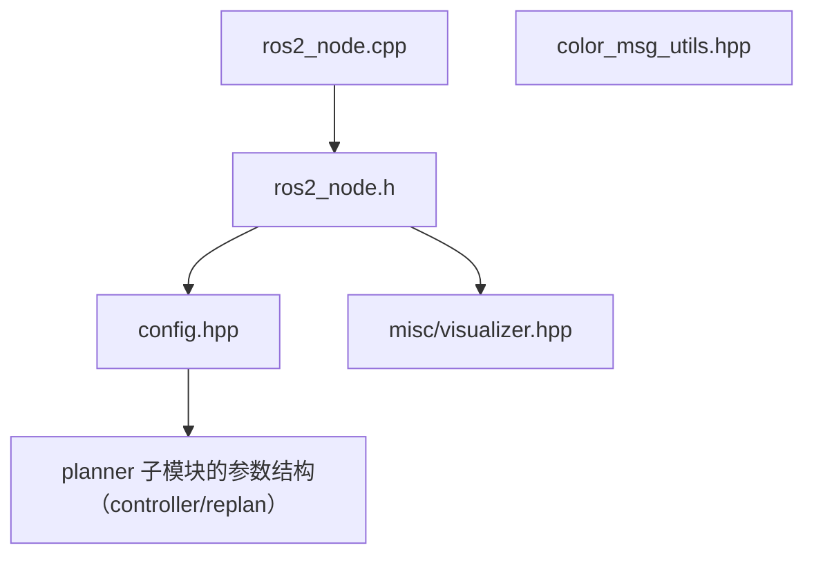

# ros2 模块 依赖关系

## CMake target 与链接依赖

| 项 | 值 | 锚点 |
|---|---|---|
| 工程名 / 库名 | `ros2`（用 `ament_auto_add_library`） | `src/ros2/CMakeLists.txt:3` |
| 源文件收集 | `file(GLOB_RECURSE sources CONFIGURE_DEPENDS "src/*.cpp")` | `src/ros2/CMakeLists.txt:5` |
| target 类型 | ament 库 | `src/ros2/CMakeLists.txt:7-9` |
| include 可见性 | `PUBLIC include` | `src/ros2/CMakeLists.txt:11` |
| ROS include | 由各消息包变量拼接（rclcpp、5 类消息、PCL 互转、tf2、std_srvs） | `src/ros2/CMakeLists.txt:13-23` |
| ROS 链接 | `PUBLIC`：rclcpp、消息库、tf2、tf2_ros | `src/ros2/CMakeLists.txt:26-37` |
| PRIVATE 链接 | spdlog、utils、yaml-cpp、PCL、地图与四个 planner 模块 | `src/ros2/CMakeLists.txt:39-49` |
| 构建顺序 | planner 全部子目录之后（最后加入） | `CMakeLists.txt:72` |
| 顶层可执行 | `ma_nav` 链接本模块 | `CMakeLists.txt:94` |

【事实】本模块是**唯一**把 ROS 依赖设为 `PUBLIC` 的模块，因此下游（可执行文件）
自动继承消息类型与 rclcpp 的 include（`src/ros2/CMakeLists.txt:13` 的 include 块与 `src/ros2/CMakeLists.txt:26` 的链接声明）。

## 外部库依赖

| 库 | 用途 | 证据 |
|---|---|---|
| `rclcpp::rclcpp` | 节点、执行器、发布订阅与服务 | `src/ros2/CMakeLists.txt:26` |
| 各消息包（nav/geometry/sensor/visualization/std_msgs/std_srvs） | 话题与服务消息类型 | `src/ros2/CMakeLists.txt:27-33` |
| `tf2` / `tf2_ros` | 坐标变换依赖（本模块直接使用的仅有消息与位姿） | `src/ros2/CMakeLists.txt:35-36` |
| `pcl_conversions` | 点云消息与 PCL 类型互转 | `src/ros2/CMakeLists.txt:34` |
| `yaml-cpp` | 参数文件与隧道区域文件读写 | `src/ros2/CMakeLists.txt:42` |
| `spdlog` | 日志后端（经 utils） | `src/ros2/CMakeLists.txt:40` |

## 模块内依赖

| 依赖方 | 被依赖 | 锚点 |
|---|---|---|
| `ros2_node.h` | `config.hpp` | `src/ros2/include/ros2/ros2_node.h:2` |
| `ros2_node.h` | 可视化头 | `src/ros2/include/ros2/ros2_node.h:44` |
| `ros2_node.cpp` | 自身头文件 | `src/ros2/src/ros2_node.cpp:1` |
| `config.hpp` | MPC 与重规划的参数结构 | `src/ros2/include/ros2/config.hpp:2-3` |

【事实】`color_msg_utils.hpp` 只被可视化头 include
（`src/ros2/include/ros2/misc/visualizer.hpp:9`），节点主体不直接引用颜色工具。

## 跨模块依赖

### ros2 依赖谁

| 被依赖模块 | 依赖点 | 锚点 |
|---|---|---|
| map | 地图门面与栅格类型 | `src/ros2/include/ros2/ros2_node.h:6` |
| controller | MPC 与轨迹接口 | `src/ros2/include/ros2/ros2_node.h:10-12` |
| replan | 重规划门面与状态枚举 | `src/ros2/include/ros2/ros2_node.h:13` |
| utils | 机器人状态类型与绘图器 | `src/ros2/include/ros2/ros2_node.h:22-23` |
| traj_optimize | 优化输出的样条类型（含 gcopter 轨迹头） | `src/ros2/include/ros2/misc/visualizer.hpp:5-7` |
| path_planning | 折叠与后处理参数（经 Config） | `src/ros2/include/ros2/config.hpp:2` |

### 谁依赖 ros2

| 依赖方 | 依赖点 | 锚点 |
|---|---|---|
| 可执行文件 `ma_nav` | include 节点头并构造节点主体 | `src/ma_nav.cpp:1` |
| 顶层构建 | ma_nav 可执行文件链接本模块 | `CMakeLists.txt:94` |

【事实】planner 的四个子模块**都不依赖** ros2：依赖方向是单向的
（`src/planner/*/CMakeLists.txt` 的链接列表里没有 ros2），
因此算法层可以脱离 ROS 单独编译与测试。

## 依赖风险

| # | 风险 | 说明 | 锚点 | 类型 |
|---|---|---|---|---|
| 1 | 本模块是唯一的集成点 | 所有模块的接口改动最终都在这里实例化，编译错误集中在此 | `src/ros2/CMakeLists.txt:39-49` | 【事实】 |
| 2 | 参数文件耦合四个模块的结构 | Config 直接 include controller 与 replan 的参数结构，任一模块改参数布局都会影响本模块 | `src/ros2/include/ros2/config.hpp:2-3` | 【事实】 |
| 3 | ROS 依赖是 PUBLIC | 下游会继承消息依赖，若改为 PRIVATE 可能破坏可执行文件编译 | `src/ros2/CMakeLists.txt:25` | 【推断】 |
| 4 | 全局命名空间的可视化类 | `Visualizer` 不在命名空间内，与其它模块潜在同名风险 | `src/ros2/include/ros2/misc/visualizer.hpp:27` | 【事实】 |
| 5 | 地图存取格式自研 | 直接读写 PGM/YAML，不依赖 ROS 地图服务，格式兼容性由本模块负责 | `src/ros2/src/ros2_node.cpp:558` | 【事实】 |
| 6 | 可视化头很重 | 1487 行且被节点头 include，任何可视化改动都会重编译节点 | `src/ros2/include/ros2/ros2_node.h:44` | 【事实】 |
