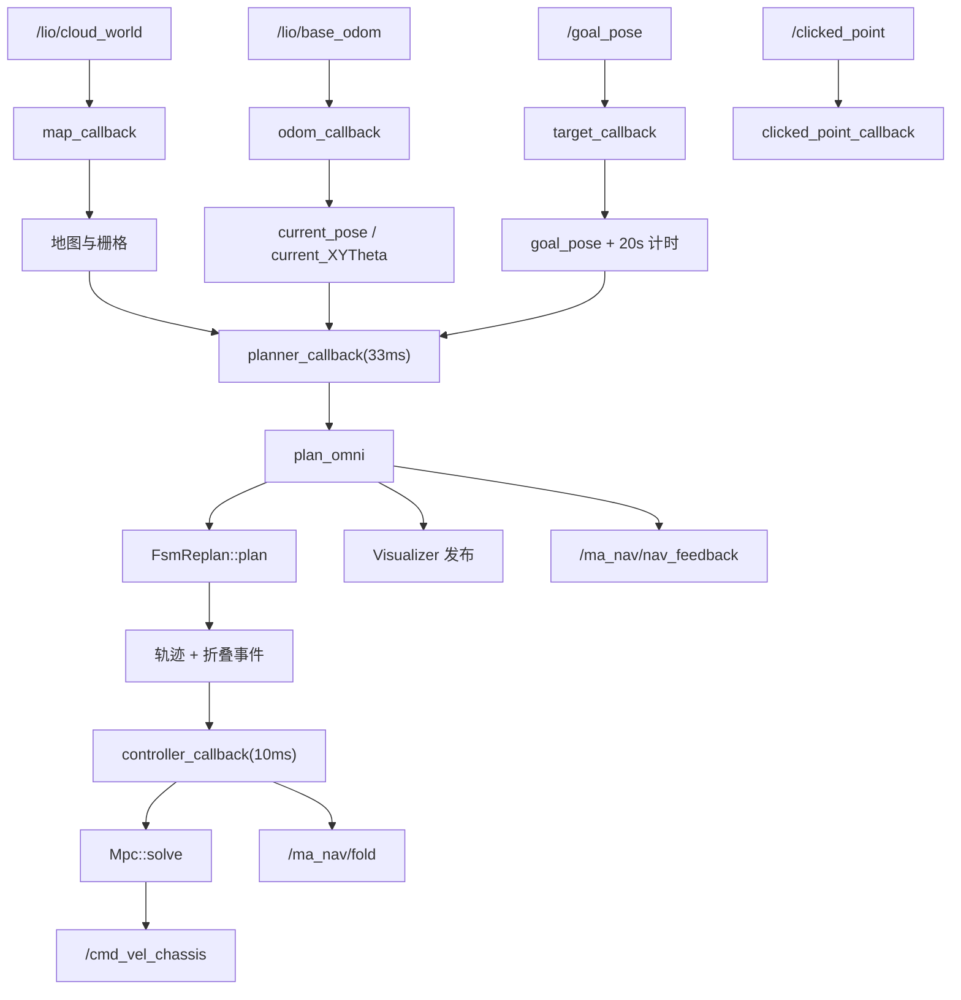
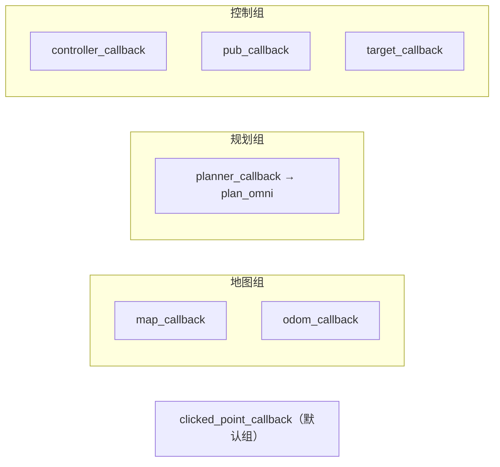
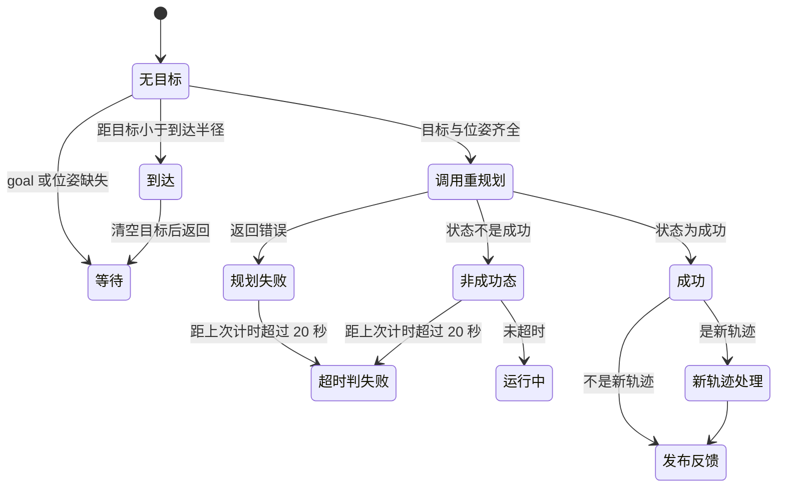
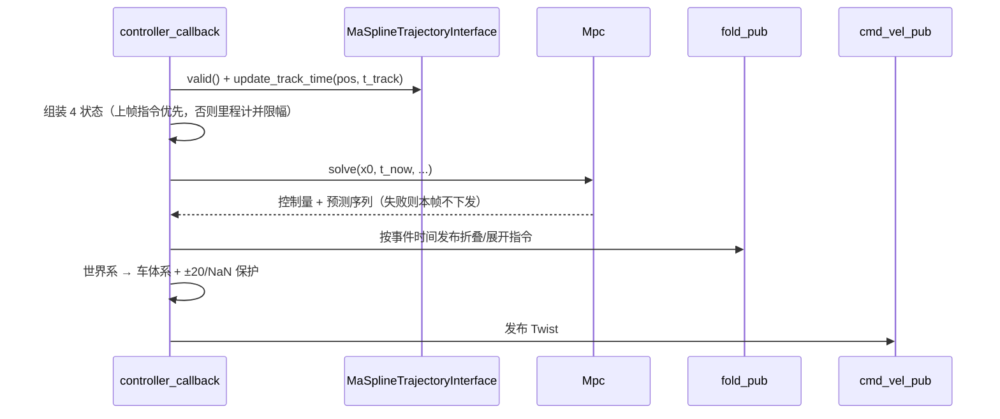

# ros2 模块 流程图（Mermaid）

> 每个节点都对应真实符号；节点表逐条给出锚点。

## 系统数据流

| 节点 | 对应符号 | 锚点 |
|---|---|---|
| A | 点云订阅 | `src/ros2/src/ros2_node.cpp:51` |
| B | `planner::GlobalPlanner2d::map_callback` | `src/ros2/src/ros2_node.cpp:429` |
| C | 里程计订阅 | `src/ros2/src/ros2_node.cpp:58` |
| D | `planner::GlobalPlanner2d::odom_callback` | `src/ros2/src/ros2_node.cpp:394` |
| E | 目标订阅 | `src/ros2/src/ros2_node.cpp:65` |
| F | `planner::GlobalPlanner2d::target_callback` | `src/ros2/src/ros2_node.cpp:459` |
| G/H | 点选点订阅与回调 | `src/ros2/src/ros2_node.cpp:493` |
| I | 地图更新 | `src/ros2/src/ros2_node.cpp:435-437` |
| L | 规划定时器回调 | `src/ros2/src/ros2_node.cpp:245` |
| M | `planner::GlobalPlanner2d::plan_omni` | `src/ros2/src/ros2_node.cpp:248` |
| N | 重规划门面调用 | `src/ros2/src/ros2_node.cpp:272` |
| O | 折叠事件生成 | `src/ros2/src/ros2_node.cpp:315-321` |
| P | `planner::GlobalPlanner2d::controller_callback` | `src/ros2/src/ros2_node.cpp:130` |
| Q | MPC 求解 | `src/ros2/src/ros2_node.cpp:179` |
| R | 速度指令发布 | `src/ros2/src/ros2_node.cpp:242` |
| S | 折叠指令发布 | `src/ros2/src/ros2_node.cpp:206` |
| T | 可视化发布 | `src/ros2/src/ros2_node.cpp:298-299` |
| U | 导航反馈发布 | `src/ros2/src/ros2_node.cpp:370` |

## 回调组与线程分工

| 组 / 回调 | 周期或触发 | 锚点 |
|---|---|---|
| 三个互斥回调组 | 建组 | `src/ros2/src/ros2_node.cpp:38-40` |
| 地图组 | 点云与里程计（都写地图） | `src/ros2/src/ros2_node.cpp:44-46` |
| 规划组 | 33 ms 定时器 | `src/ros2/src/ros2_node.cpp:73-77` |
| 控制组 | 10 ms 控制器 + 10 ms 可视化 + 目标回调 | `src/ros2/src/ros2_node.cpp:79-89` |
| 点选回调 | 默认组（未指定） | `src/ros2/src/ros2_node.cpp:93-97` |

## 规划流程（plan_omni）

| 状态/迁移 | 对应符号 | 锚点 |
|---|---|---|
| 缺目标/位姿 | 直接返回 | `src/ros2/src/ros2_node.cpp:249-256` |
| 到达 | 置成功、发布反馈、清空目标 | `src/ros2/src/ros2_node.cpp:260-269` |
| 20 秒判失败 | 首次失败开始计时 | `src/ros2/src/ros2_node.cpp:271-279` |
| 未超时 | 置运行中 | `src/ros2/src/ros2_node.cpp:290-293` |
| 新轨迹处理 | 更新 MPC 目标、重算折叠事件、定位跟踪游标 | `src/ros2/src/ros2_node.cpp:308-344` |
| 发布反馈 | 组装并发布导航反馈 | `src/ros2/src/ros2_node.cpp:368-370` |

【事实】到达判定在**任何**目标位姿齐备的帧都会先执行，且不依赖 20 s 计时成员是否已初始化
（`src/ros2/src/ros2_node.cpp:257-269`）。

## 控制流程（controller_callback）

| 步骤 | 对应符号 | 锚点 |
|---|---|---|
| 前置检查 | 无位姿或无有效轨迹直接返回 | `src/ros2/src/ros2_node.cpp:131-136` |
| 跟踪游标 | 用当前位置更新时间游标 | `src/ros2/src/ros2_node.cpp:140` |
| 速度状态 | 上帧 MPC 指令优先；首帧用里程计并限幅 | `src/ros2/src/ros2_node.cpp:153-169` |
| 折叠消费 | 按跟踪时间排空到期的折叠事件 | `src/ros2/src/ros2_node.cpp:197-216` |
| 坐标变换 | 世界系 → 车体系，且角速度为 0 | `src/ros2/src/ros2_node.cpp:222-226` |
| 发布保护 | ±20 与 NaN 三重检查 | `src/ros2/src/ros2_node.cpp:228-240` |

## 折叠事件链路

| 步骤 | 对应符号 | 锚点 |
|---|---|---|
| 区间检测 | 时间等间隔采样 + 地图隧道语义 | `src/ros2/src/ros2_node.cpp:883-898` |
| 区间合并 | 间隔小于折叠+展开+两倍裕量则合并 | `src/ros2/src/ros2_node.cpp:935-945` |
| 事件生成 | 入口提前折叠时间+裕量，出口延后裕量 | `src/ros2/src/ros2_node.cpp:950-959` |
| 排序去重 | 按时间排序并压缩同状态 | `src/ros2/src/ros2_node.cpp:962-973` |
| 消费 | 跟踪时间越过事件时间即下发 | `src/ros2/src/ros2_node.cpp:197-216` |
| 新轨迹对齐 | 跳过已过去的事件，并把「应有折叠状态」写进记账变量——**但补发指令的那行被注释掉了**，指令与记账状态会静默发散 | `src/ros2/src/ros2_node.cpp:325-338` |

【事实】折叠时间、展开时间与裕量都来自**搜索后处理参数**
（`src/ros2/src/ros2_node.cpp:318-320`），
而不是节点头里那三个未被使用的常量
（`src/ros2/include/ros2/ros2_node.h:119-121`）。
