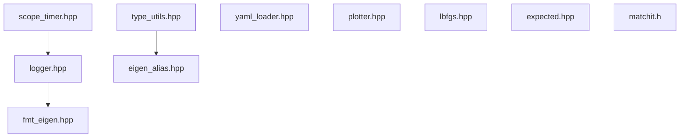

# utils 模块 依赖关系

## CMake target 与链接依赖

| 项 | 值 | 锚点 |
|---|---|---|
| 工程名 / 库名 | `utils` | `src/utils/CMakeLists.txt:3` |
| 源文件收集 | `file(GLOB_RECURSE sources CONFIGURE_DEPENDS "src/*.cpp")`（只匹配到那个空文件） | `src/utils/CMakeLists.txt:5` |
| target 类型 | 普通库目标：`add_library` 未指定类型，仓库也未设 BUILD_SHARED_LIBS（故默认 STATIC），无 ament 包装 | `src/utils/CMakeLists.txt:7` |
| 源文件 | 私有加入唯一的 .cpp | `src/utils/CMakeLists.txt:9` |
| include 可见性 | `PUBLIC include` | `src/utils/CMakeLists.txt:11` |
| 链接依赖 | **PRIVATE**：spdlog、yaml-cpp | `src/utils/CMakeLists.txt:13-16` |
| 构建顺序 | 顶层最先加入的子目录 | `CMakeLists.txt:66` |

【事实】本模块的库目标**不依赖 ROS**：`src/utils/CMakeLists.txt:1-16` 中没有 ament
与任何 ROS 包。注意这并非本模块独有——map 与 planner 的四个模块同样不依赖 ROS，
只有 ros2 依赖（`src/ros2/CMakeLists.txt:1-9`）。

【推断】因此单独构建本目标不需要 ROS；但顶层工程本身强依赖 ROS
（`CMakeLists.txt:38-49`），脱离该工程构建需自备 spdlog/yaml-cpp/Eigen。

【事实】**依赖声明与公共头不匹配**：spdlog 与 yaml-cpp 被声明为 PRIVATE，
但公共头直接 include 它们
（`src/utils/include/utils/logger.hpp:5-8`、`src/utils/include/utils/yaml_loader.hpp:12`），
因此任何 include 这些头的下游都必须自己具备这两个包（见风险 1）。

## 外部库依赖

| 库 | 用途 | 是否在 CMake 声明 | 证据 |
|---|---|---|---|
| `spdlog` | 日志后端 | 是（PRIVATE） | `src/utils/CMakeLists.txt:14` |
| `yaml-cpp` | 参数文件解析 | 是（PRIVATE） | `src/utils/CMakeLists.txt:15` |
| `Eigen` | 别名、状态类型、L-BFGS 单头 | 本模块未声明；由顶层统一 `find_package` 提供 | `CMakeLists.txt:51` |
| `fmt` | 日志格式化与 Eigen 格式化 | **否**（经 spdlog 传递） | `src/utils/include/utils/fmt_eigen.hpp:27` |
| `nlohmann/json` | 绘图器的 JSON 序列化 | 本模块未声明；顶层同名声明**被注释掉**，只能依赖系统安装 | `CMakeLists.txt:59` |
| POSIX socket | 绘图器的 UDP 发送 | 否（系统库） | `src/utils/include/utils/plotter.hpp:4-5` |

## 模块内依赖

| 依赖方 | 被依赖 | 锚点 |
|---|---|---|
| 计时器 | 日志（写计时通道） | `src/utils/include/utils/scope_timer.hpp:30` |
| 状态类型 | Eigen 别名 | `src/utils/include/utils/type_utils.hpp:9` |
| 日志 | Eigen 的 fmt 格式化 | `src/utils/include/utils/logger.hpp:3` |

【事实】三个第三方单头（L-BFGS、expected、matchit）在模块内**互不依赖、也无人 include**
（`src/utils/include/utils/lbfgs.hpp:1-8`），只作为可被业务直接使用的独立文件存在。

## 被谁依赖（模块外消费者）

| 消费者模块 | 用到的头 | 引用点数 | 代表锚点 |
|---|---|---|---|
| map | 日志、状态类型、YAML 装载、别名、计时 | 最多（日志 15 处、状态类型 10 处） | `src/map/include/map/3d_occ_map/config.hpp:68` |
| planner/path_planning | 日志、计时 | 少量 | `src/planner/path_planning/src/path_planning.cpp:36` |
| planner/traj_optimize | L-BFGS、expected、日志（**不含计时**：该模块内无计时工具引用） | 中 | `src/planner/traj_optimize/include/traj_optimize/ma_spline_opt/traj_optimizer.h:7-8` |
| planner/controller | 日志（经接口头隐式引入） | 少量 | `src/planner/controller/include/controller/mpc.h:6` |
| planner/replan | expected、日志、类型、**计时** | 中 | `src/planner/replan/include/replan/fsm_replanner.h:9-11` |
| ros2 | 日志、状态类型、别名、绘图器 | 中 | `src/ros2/include/ros2/ros2_node.h:22-23` |

【事实】`plotter.hpp` 的引用链是：节点头（`src/ros2/include/ros2/ros2_node.h:22`）与节点实现（`src/ros2/src/ros2_node.cpp:7`）各 include 一次，并声明一个成员
（`src/ros2/include/ros2/ros2_node.h:109`），而该成员本身没有使用点；
`matchit.h` 则没有任何引用点。

## 依赖风险

| # | 风险 | 说明 | 锚点 | 类型 |
|---|---|---|---|---|
| 1 | 公共头的依赖是 PRIVATE | 下游 include `logger.hpp`/`yaml_loader.hpp` 时必须自行提供 spdlog/yaml-cpp，否则编译失败且报错位置在下游 | `src/utils/CMakeLists.txt:13` | 【事实】 |
| 2 | Eigen 与 nlohmann 未在本模块声明 | Eigen 由顶层统一 find_package 提供，本模块只是没写；nlohmann 连顶层声明都被注释 | `src/utils/include/utils/eigen_alias.hpp:10`、`CMakeLists.txt:59` | 【事实】 |
| 3 | 全仓库最底层 | 本模块一改，所有模块都要重编译；同时它不能反向依赖任何业务模块 | `CMakeLists.txt:66` | 【事实】 |
| 4 | 头文件即接口 | 纯头文件库没有二进制边界，任何头内改动都会传播到全部下游 | `src/utils/src/utils.cpp:1` | 【事实】 |
| 5 | 一个第三方单头无人使用 | matchit 2204 行随库维护但不被任何代码引用 | `src/utils/include/utils/matchit.h:16` | 【事实】 |
| 6 | Eigen include 风格不一致 | L-BFGS 单头用 `eigen3/Eigen/Eigen` 前缀，对 include 路径敏感 | `src/utils/include/utils/lbfgs.hpp:4` | 【事实】 |
