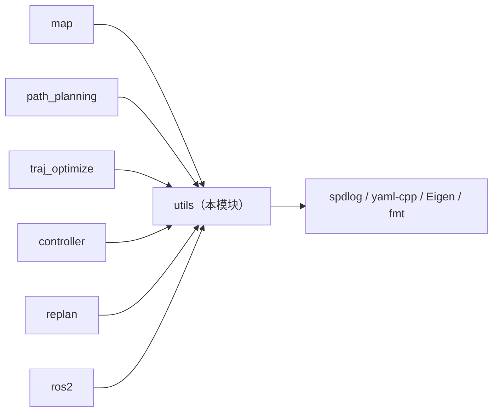
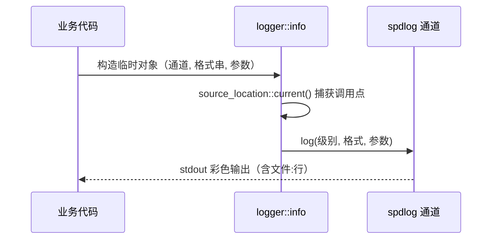
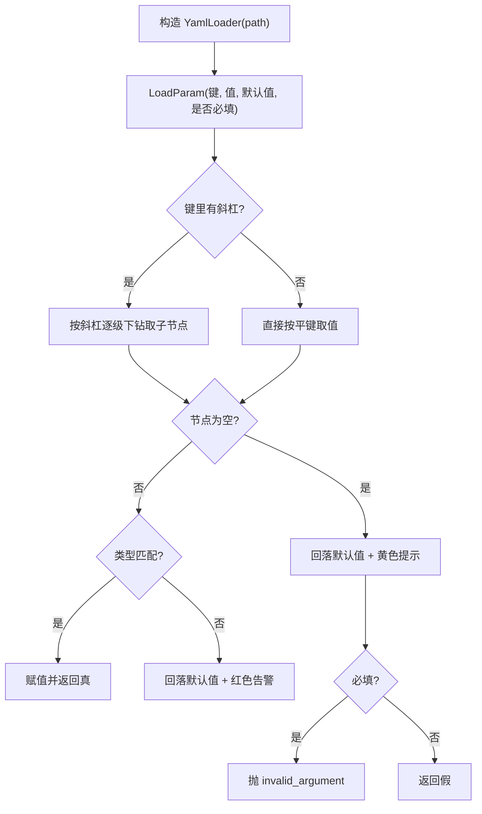
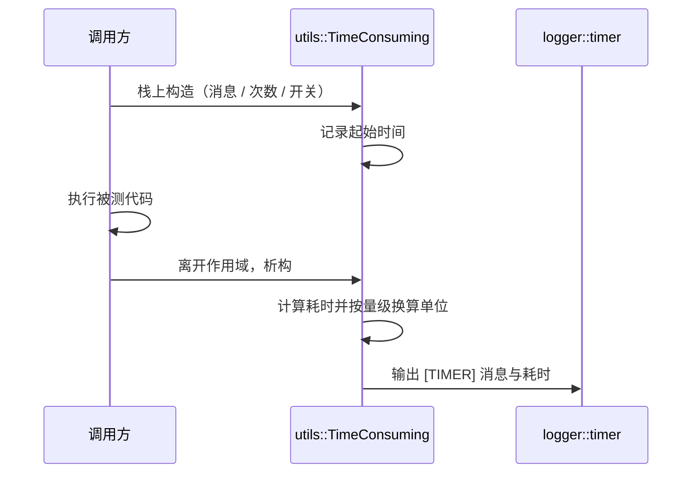
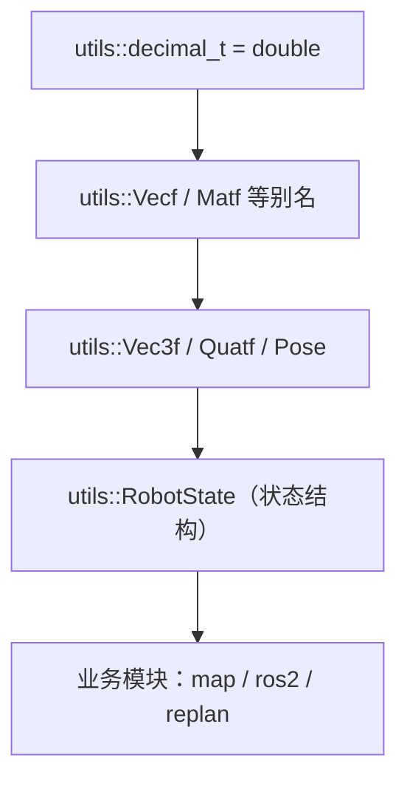

# utils 模块 流程图（Mermaid）

> 每个节点都对应真实符号；节点表逐条给出锚点。

## 模块在依赖图中的位置

| 节点 / 边 | 对应符号或文件 | 锚点 |
|---|---|---|
| utils 库 target | 库定义 | `src/utils/CMakeLists.txt:7` |
| map → utils | YAML 装载 | `src/map/include/map/3d_occ_map/config.hpp:68` |
| traj_optimize → utils | L-BFGS 与 expected | `src/planner/traj_optimize/include/traj_optimize/ma_spline_opt/traj_optimizer.h:7-8` |
| path_planning → utils | 日志与计时 | `src/planner/path_planning/src/path_planning.cpp:36` |
| controller → utils | 日志（经接口头隐式引入） | `src/planner/controller/include/controller/mpc.h:6` |
| replan → utils | expected 与计时 | `src/planner/replan/include/replan/fsm_replanner.h:9`、`src/planner/replan/src/fsm_replanner.cpp:59` |
| ros2 → utils | 日志与状态类型 | `src/ros2/include/ros2/ros2_node.h:22-23` |
| utils → spdlog | 日志后端 | `src/utils/include/utils/logger.hpp:5-8` |
| utils → yaml-cpp | 参数解析 | `src/utils/include/utils/yaml_loader.hpp:12` |
| utils → Eigen | 别名与单头 | `src/utils/include/utils/eigen_alias.hpp:10` |
| utils → fmt | 日志格式化与 Eigen 格式化 | `src/utils/include/utils/fmt_eigen.hpp:27` |
| utils → nlohmann/json | 绘图器的 JSON 序列化（未在 CMake 声明） | `src/utils/include/utils/plotter.hpp:8` |

## 日志调用链

| 步骤 | 对应符号 | 锚点 |
|---|---|---|
| 业务侧写法 | 构造 `logger::info` 等临时对象 | `src/utils/include/utils/logger.hpp:13` |
| 调用点捕获 | 默认参数使用 `std::source_location::current()` | `src/utils/include/utils/logger.hpp:17` |
| 实际写出 | 调 spdlog 的 `log`，带 `source_loc` | `src/utils/include/utils/logger.hpp:19-24` |
| 通道创建 | 彩色通道工厂与 7 个预定义通道 | `src/utils/include/utils/logger.hpp:111-125` |

## 参数装载流程

| 步骤 | 对应符号 | 锚点 |
|---|---|---|
| 装载入口 | 两个模板重载（标量 / 向量） | `src/utils/include/utils/yaml_loader.hpp:33-41` |
| 路径判定 | 含斜杠则走路径解析 | `src/utils/include/utils/yaml_loader.hpp:51-53` |
| 读文件 | 每次装载都重新读取 | `src/utils/include/utils/yaml_loader.hpp:49` |
| 类型校验 | 向量需序列节点，否则回落 | `src/utils/include/utils/yaml_loader.hpp:62-80` |
| 必填语义 | 只有必填才抛异常 | `src/utils/include/utils/yaml_loader.hpp:100-102` |
| 路径下钻 | 逐级取键，缺失返回空节点 | `src/utils/include/utils/yaml_loader.hpp:125-148` |

## 计时器时序

| 步骤 | 对应符号 | 锚点 |
|---|---|---|
| 构造 | 两种有定义的构造形式（无参构造只有声明、无定义，勿用） | `src/utils/include/utils/scope_timer.hpp:42-60` |
| 析构与上报 | 按量级选择 ns/us/ms/s | `src/utils/include/utils/scope_timer.hpp:62-79` |
| 开关 | 运行时可关闭 | `src/utils/include/utils/scope_timer.hpp:82` |
| 重启 | 手动重新计时 | `src/utils/include/utils/scope_timer.hpp:86` |
| 消费方 | 计时通道 | `src/utils/include/utils/logger.hpp:125` |

## 类型别名传播

| 层级 | 对应符号 | 锚点 |
|---|---|---|
| 标量 | 全局精度类型 | `src/utils/include/utils/eigen_alias.hpp:22` |
| 容器别名 | 向量/矩阵/向量之向量 | `src/utils/include/utils/eigen_alias.hpp:26-49` |
| 常用别名 | 2/3/4 维与四元数、位姿 | `src/utils/include/utils/eigen_alias.hpp:52-134` |
| 业务结构 | 机器人状态 | `src/utils/include/utils/type_utils.hpp:69` |
