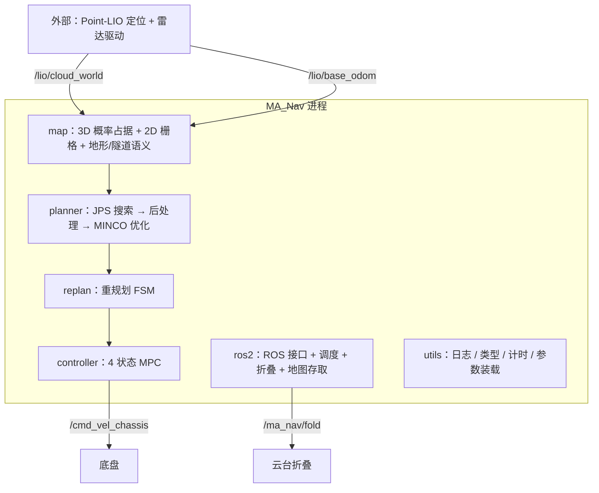

# MA_Nav 算法思路总览

> 本目录讲**为什么这么做、数学上怎么定义、工程上落在哪里**；
> `docs/nav/<模块>/` 下的模块文档讲**接口、参数、依赖与证据锚点**。
> 两者冲突时**以模块文档 + 代码为准**——模块文档已通过校验器与两轮独立审核。
> 本文档家族参考 `docs/nav/开源参考/` 中三份兄弟队伍技术报告的写法：
> 问题动机 → 核心思想 → 数学建模 → 工程实现 → 参数细节 → 限制与优化方向。

---

## 1 系统架构

MA_Nav 是 RM 哨兵机器人的导航栈：**单进程、单节点、单线程**（`src/ma_nav.cpp:7-19`），
由 7 个 CMake 库组成，依赖方向单向向下：

| 模块 | 一句话职责 | 算法文档 |
|---|---|---|
| map | 把点云变成**带概率的三维占据地图**，并输出可搜索的 2D 栅格、地形与隧道语义 | [map/01](./map/01-概率占据建图与滑窗.md)、[map/02](./map/02-地形与隧道语义.md)、[map/03](./map/03-ESDF距离场与避障梯度.md) |
| planner/path_planning | **JPS/A\*** 栅格搜索 + 路径后处理（5D 采样、梯形速度时间分配、折叠前降速） | [planner/02](./planner/02-全局搜索JPS与A星.md)、[planner/03](./planner/03-路径后处理与时间分配.md) |
| planner/traj_optimize | 把离散路径优化成**五次样条（MINCO 思路）**、两阶段 L-BFGS | [planner/04](./planner/04-轨迹优化MINCO与五次样条.md) |
| planner/controller | **4 状态线性 MPC**（x, y, vx, vy / ax, ay），OSQP 求解 | [planner/05](./planner/05-MPC控制器.md) |
| planner/replan | 何时重规划、起终点外推、失败判定（FSM） | [planner/06](./planner/06-重规划策略.md) |
| ros2 | 唯一的 ROS 集成层：订阅/发布、节拍调度、折叠事件、地图存取 | [planner/01](./planner/01-导航框架与数据流.md) |
| utils | 日志/计时/Eigen 别名/参数装载/第三方单头 | —（工程基础设施，见 `docs/nav/utils/`） |

## 2 端到端数据流

| 阶段 | 周期 | 入口 | 输出 |
|---|---|---|---|
| 建图 | 点云到达即触发 | `map_callback`（`src/ros2/src/ros2_node.cpp:429`） | 3D 占据概率 + 2D 栅格 |
| 状态 | 里程计到达即触发 | `odom_callback`（`src/ros2/src/ros2_node.cpp:394`） | 当前位姿/速度 |
| 规划 | 33 ms | `plan_omni`（`src/ros2/src/ros2_node.cpp:248`） | 轨迹 + 折叠事件 + 目标点 |
| 控制 | 10 ms | `controller_callback`（`src/ros2/src/ros2_node.cpp:130`） | `/cmd_vel_chassis` |
| 可视化 | 10 ms（按地图配置节流） | `pub_callback`（`src/ros2/src/ros2_node.cpp:438`） | 24 个 `/ma_nav/*` 话题 |

【事实】三个定时器周期分别是 33 ms / 10 ms / 10 ms，且规划、控制+可视化各占一个互斥回调组
（`src/ros2/src/ros2_node.cpp:73-89`）；但主循环是 `rclcpp::spin_some`（单线程），
因此当前是**顺序执行**而非并行——回调组只是分组声明。

## 3 全链路关键参数速查

| 环节 | 参数 | 当前值 | 说明 |
|---|---|---|---|
| 建图 | 占据栅格分辨率 | 0.1 m | `config/map.yaml:3`，地图尺寸 10×10×4 m（`:8`） |
| 建图 | 滑窗阈值 | 0.3 m | `config/map.yaml:29`，超阈值整图平移（原点随之移动） |
| 建图 | 遗忘阈值 | 0.6 | `config/map.yaml:48`，衰减每 5 个 batch 执行一次 |
| 建图 | ESDF | **关闭** | `config/map.yaml:32`；开启时分辨率 0.3（`:33`） |
| 地形 | 台阶/坡度阈值 | 0.15 m / 0.17 | `config/map.yaml:53`、`:55` |
| 2D 栅格 | 分辨率 / 范围 | 0.05 m / x∈[−6,+22]、y∈[−8,+8]（28 m × 16 m，560×320 格） | `config/map.yaml:64`、`:60-63` |
| 搜索 | 安全阈值 | 0.35 m | `config/planner.yaml:24`，搜索与后处理共用 |
| 搜索 | 速度/加速度上限 | 3.0 / 5.0 | `config/planner.yaml:25-26` |
| 后处理 | 时间分辨率 / 采样分辨率 | 0.4 s / 0.1 m | `config/planner.yaml:27`、`:34` |
| 后处理 | 候选轨迹数 | 5 ~ 16 | `config/planner.yaml:29-30`，配合切分长度 10（`:31`） |
| 优化 | 安全距离 | 0.35 m | `config/planner.yaml:47`，与搜索同口径 |
| 优化 | 积分采样步数 | 8 | `config/planner.yaml:50` |
| 优化 | 两阶段权重 | stage1 障碍 800 → stage2 8000 | `config/planner.yaml:66`、`:83` |
| MPC | 预测步数 / 步长 | 20 / 0.05 s | `config/planner.yaml:110-111`（预测 1 s） |
| MPC | 状态/终端权重 | Q=[30,30,1,1]、QN=[40,40,2,2] | `config/planner.yaml:114`、`:117` |
| MPC | 控制/控制增量权重 | R=Rd=[0.05,0.05] | `config/planner.yaml:120`、`:123` |
| MPC | 速度/控制硬边界 | ±3.0 m/s、±3.0 m/s² | `config/planner.yaml:126-131` |
| 重规划 | 目标偏差 / 横向偏差 | [0.2,0.2,0.0] / 0.5 m | `config/planner.yaml:94`、`:96` |
| 重规划 | 到达半径 | 0.3 m | `config/planner.yaml:98` |

## 4 与开源参考的对照

| 本项目的模块 | 参考文档中最接近的章节 | 主要差异 |
|---|---|---|
| [map/01 概率占据建图](./map/01-概率占据建图与滑窗.md) | 北理工 §7 ROGMap；中科大 §5.3 3D Occupancy Grid | 我们的滑窗/遗忘是固定节拍（每 5 batch），并在同层做膨胀与未知处理 |
| [map/02 地形与隧道语义](./map/02-地形与隧道语义.md) | 哈工大 §2.4.2.2 隧道识别；中科大 §5.4 可通行区域 | 我们的隧道语义是**点选多边形写入地图**，直接驱动云台折叠事件 |
| [map/03 ESDF](./map/03-ESDF距离场与避障梯度.md) | 哈工大 §2.4.3.2(3) ESDF 软约束；中科大 §5.5.2 | **3D ESDF 子地图关闭**；优化器的距离场实际来自 **2D 栅格自带的有符号 EDT**（`GridMapESDF` 适配），配合 `safe_distance` 软约束与搜索/后处理硬阈值 |
| [planner/02 JPS 搜索](./planner/02-全局搜索JPS与A星.md) | 哈工大 §2.4.3.1 导航框架；北理工 §8 MincoPlanner | 我们保留 JPS 与 A\* 两条实现，实际启用 JPS |
| [planner/04 MINCO 优化](./planner/04-轨迹优化MINCO与五次样条.md) | 哈工大 §2.4.3.2(4)(5) MINCO + 二度优化 | 我们的「两阶段」是**权重/迭代预算不同的两次 L-BFGS**，不是拓扑重选 |
| [planner/05 MPC](./planner/05-MPC控制器.md) | 哈工大 §2.4.3.3；北理工 §9 SE(2) MPC | 我们是 4 状态（x,y,vx,vy）线性 MPC、OSQP + 热启动，输出加速度控制量 |
| [planner/06 重规划](./planner/06-重规划策略.md) | 哈工大 §2.4.3.2(7) 重规划策略 | 我们的触发是三类条件 + 标志残留，失败**没有兜底** |

## 5 阅读顺序建议

1. 先看本页与 [planner/01 导航框架与数据流](./planner/01-导航框架与数据流.md)：把数据流与节拍建立起来。
2. 再看感知侧 [map/01](./map/01-概率占据建图与滑窗.md) → [map/02](./map/02-地形与隧道语义.md) → [map/03](./map/03-ESDF距离场与避障梯度.md)。
3. 然后规划侧 [planner/02](./planner/02-全局搜索JPS与A星.md) → [03](./planner/03-路径后处理与时间分配.md) → [04](./planner/04-轨迹优化MINCO与五次样条.md)。
4. 最后控制与容错 [planner/05](./planner/05-MPC控制器.md) → [06](./planner/06-重规划策略.md)。

## 6 文档约定

| 约定 | 含义 |
|---|---|
| `路径:行号` | 事实锚点，可直接跳到代码；行号相对本目录文档的生成基线（见各文 front-matter 或末节） |
| 【事实】 | 代码里能直接读到 |
| 【推断】 | 由事实推导，但代码没有直说（会给出推导依据） |
| 【待确认】 | 代码与文档/注释不一致，或证据不足，需作者确认 |

【事实】本目录不参与 `docs/nav/<模块>/` 那套 9 文件契约校验（那套面向工程接口），
因此这里的篇幅与结构服从「技术报告」写法；但凡涉及**行为与数值**的结论，都要求在
`docs/nav/<模块>/` 里已有对应证据。
