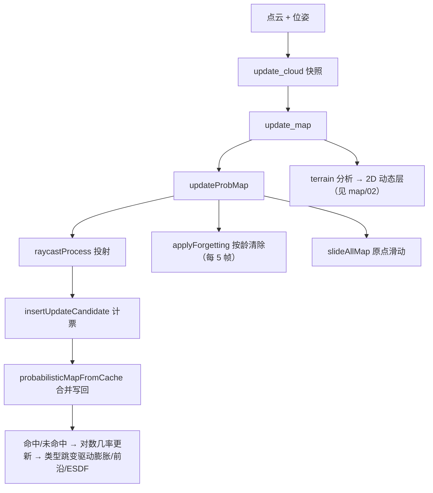

# 概率占据建图与滑窗

> **阅读约定**：锚点 `路径:行号` 相对基线 `git_rev 8f98daee5bc7`，可直接跳转。
> 【事实】代码里能直接读到；【推断】由事实推导、代码没直说（给出依据）；【待确认】两侧对不上。
> 本文与 `docs/nav/map/` 的关系：模块文档讲**接口、参数与证据**，本文讲**为什么这样做、数学上是什么、落在哪一行**；
> 冲突时以模块文档 + 代码为准。

---

## 1 方案概述

| 项 | 内容 |
|---|---|
| 输入 | 世界系点云 `/lio/cloud_world`（`src/ros2/src/ros2_node.cpp:51`）与里程计位姿（`:58`） |
| 输出 | ①带概率的三维占据体素；②三态查询（占据/未知/已知自由）；③由它派生的膨胀层与 2D 栅格 |
| 入口 | `MaMap::update_cloud`（`src/map/include/map/ma_map.hpp:102`）→ `MaMap::update_map`（`:50`）→ `ProbMap::updateProbMap`（`src/map/src/prob_map.cpp:302`） |
| 当前规模/状态 | 分辨率 0.1 m、配置尺寸 10×10×4 m（**实际 101×101×41 = 418 241 格**【推断】，`config/map.yaml:3`、`:8`）；滑窗开（阈值 0.3 m，`:28-29`）、遗忘 0.6 s（`:48`）、ESDF 关（`:32`） |

**为什么要概率**：单帧点云受噪声、动态物体与遮挡影响，扫到一次就永久置 1 会同时产生幽灵障碍与漏检；
本模块把占据程度写成**可累加的对数几率**，由多帧观测投票决定状态（`src/map/src/prob_map.cpp:583`）。
**为什么要滑窗**：全局体素图的内存与单帧代价都不可控，本模块只维护**固定大小的局部块**，
机器人跑远时整块平移、越界格清零（`src/map/src/sliding_map.cpp:125`）。

## 2 核心思想

### 2.1 用对数几率让概率「可加」

直接相乘概率会下溢且需要乘法；取对数几率后**贝叶斯更新退化成加法**，命中 $n$ 次就加 $n\cdot l_{hit}$，只需一次读改写
（`src/map/src/prob_map.cpp:583`、`src/map/include/map/3d_occ_map/config.hpp:217`）；代价是必须显式夹紧上下界（`:584-586`）。

### 2.2 批量投票：先计票，再写回

一次 `updateProbMap` 只做「投射 + 计票」，概率写回推迟到计票结束（`src/map/src/prob_map.cpp:331-339`、`:547-569`）：
同一格在一帧里会被多条射线反复扫到，逐次写回会把一次读改写放大成几十次；先累加 `operation_cnt`/`hit_cnt`，最后一格只写一次。
【推断】`batch_update_counter` 想表达的正是「一帧内的多次观测算一个批次」，但当前配成 1（`config/map.yaml:70`），批次边界等于帧边界。

### 2.3 局部滑窗：全局坐标 → 环形缓冲的模运算

滑窗必须回答「全局体素存在局部缓冲的第几个槽位」：本模块用**模运算 + 符号归一化**把全局索引映射进 $[-\text{half},\text{half}]$，
再用行主序步长压成一维哈希（`src/map/src/sliding_map.cpp:180-182`），代码注释标注它对应 ROG-Map 论文式 (7)(8)（`:213-217`）。

### 2.4 类型跳变驱动多层

只有**状态跳变**（未知↔自由↔占据）时才更新膨胀层与 ESDF（`src/map/src/prob_map.cpp:598-612`、`:639-654`），
避免每帧遍历所有格重建膨胀；代价是「跳变回调」与「状态判定」必须共用同一套阈值（`src/map/include/map/3d_occ_map/prob_map.h:154-166`）。

### 2.5 按龄遗忘：是「硬清除」，不是概率衰减

工程实现是：占据格记一个「变为占据的时刻」，超过阈值整格清成未知，且每 5 帧才扫一次
（`src/map/src/prob_map.cpp:591`、`:827-851`、`:348-353`）。【推断】这是**二值化的按龄清除**，
与 ROG-Map 论文「概率随时间向 0.5 衰减」不同：没有缓慢变淡的中间态，行为可预测，但阈值附近会跳变。

## 3 数学建模

### 3.1 记号约定

| 记号 | 含义 | 取值来源 |
|---|---|---|
| $r$ | 体素分辨率 | 0.1 m（`config/map.yaml:3`） |
| $N=(N_x,N_y,N_z)$ | 局部体素维度 | $N=2\cdot\text{half}+1$（`src/map/src/sliding_map.cpp` 初始化） |
| $p_{hit},p_{miss}$ | 命中/未命中的观测概率 | 0.9 / 0.49（`config/map.yaml:80`、`:77`） |
| $p_{free},p_{occ}$ | 判定「自由/占据」的阈值概率 | 0.499 / 0.85（`config/map.yaml:78`、`:79`） |
| $p_{min},p_{max}$ | 对数几率的下/上饱和概率 | 0.12 / 0.98（`config/map.yaml:76`、`:81`） |
| $l_{hit},l_{miss}$ | 命中/未命中的对数几率增量 | $\operatorname{logit}(p)$（`src/map/include/map/3d_occ_map/config.hpp:218-219`） |
| $l_{free},l_{occ}$ | 自由/占据判定阈值 | $\operatorname{logit}(p_{free}),\operatorname{logit}(p_{occ})$ |
| $l_{min},l_{max}$ | 对数几率上下界 | $\operatorname{logit}(p_{min}),\operatorname{logit}(p_{max})$ |
| $L(\mathbf{x})$ | 体素 $\mathbf{x}$ 的占据对数几率（`occupancy_buffer_`） | `src/map/include/map/3d_occ_map/prob_map.h:122` |
| $T(\mathbf{x})$ | 体素变为占据的时刻（纪元秒） | `src/map/include/map/3d_occ_map/prob_map.h:123` |
| $c_{op},c_{hit}$ | 一个批次内的操作票数/命中票数 | `src/map/include/map/3d_occ_map/prob_map.h:130-131` |
| $h(\mathbf{i})$ | 全局索引 → 一维槽位 | `src/map/src/sliding_map.cpp:180` |

### 3.2 对数几率与阈值

代码用宏实现转换，避免每次调用：

$$
\operatorname{logit}(p)=\ln\frac{p}{1-p},\qquad
l_{hit}=\operatorname{logit}(p_{hit}),\quad
l_{miss}=\operatorname{logit}(p_{miss}),\quad
l_{free}=\operatorname{logit}(p_{free}),\quad
l_{occ}=\operatorname{logit}(p_{occ})
$$

【事实】宏定义与六个换算都在 `src/map/include/map/3d_occ_map/config.hpp:217-223`。

【推断】代入当前 YAML 取值（本文计算，代码未硬编码）：
$l_{hit}=+2.197$、$l_{miss}=-0.040$、$l_{free}=-0.004$、$l_{occ}=+1.735$、$l_{min}=-1.992$、$l_{max}=+3.892$。

### 3.3 命中 / 未命中的更新

命中（射线终点落在该格）：

$$
L_k \leftarrow \operatorname{clamp}\big(L_{k-1}+c_{hit}\cdot l_{hit},\; l_{min},\; l_{max}\big)
$$

未命中（射线**穿过**该格）：

$$
L_k \leftarrow \operatorname{clamp}\big(L_{k-1}+c_{miss}\cdot l_{miss},\; l_{min},\; l_{max}\big)
$$

【事实】命中式见 `src/map/src/prob_map.cpp:583-586`，未命中式见 `:625-628`；
两处都用同一个 `clamp` 语义（越界即取边界，不是丢弃）。

### 3.4 三态判定

$$
\text{state}(L)=
\begin{cases}
\text{KNOWN\_FREE}, & L < l_{free}\\
\text{UNKNOWN}, & l_{free}\le L < l_{occ}\\
\text{OCCUPIED}, & L \ge l_{occ}
\end{cases}
$$

【事实】三个判定函数都写成内联比较（`src/map/include/map/3d_occ_map/prob_map.h:156-166`），
并在注释里给出同样的区间描述（`:154-155`）。

【推断】$l_{free}$ 略小于 0，因此**初值 $L=0$ 落在未知区间**（$-0.004\le 0<1.735$）——这正是滑窗/遗忘清除直接用 0 表示「未知」的原因（`src/map/src/prob_map.cpp:544`；`:816` 用中点，结果同样落在未知区间）。

### 3.5 一次扫描内的投票聚合

设一个批次内某格被命中 $c_{hit}$ 次、被任意射线覆盖 $c_{op}$ 次，则写回时：

$$
\text{若 } c_{hit}>0:\; L\leftarrow L+c_{hit}l_{hit};\qquad
\text{否则}:\; L\leftarrow L+(c_{op}-c_{hit})l_{miss}
$$

【事实】聚合与优先级（命中优先于未命中）在 `src/map/src/prob_map.cpp:561-565`；
票数在 `insertUpdateCandidate` 内累加（`:774-783`），队列只在**某格第一次被触碰**时入队（`:777-779`），
因此指针数组 `operation_cnt`/`hit_cnt` 兼作「去重集合」。

### 3.6 翻转一格需要多少票

代码显式算了两个「翻转票数」并在启动时打印
（`src/map/include/map/3d_occ_map/config.hpp:225-226`）：

$$
n_{occ}=\left\lceil \frac{l_{occ}}{l_{hit}}\right\rceil,\qquad
n_{free}=\left\lceil \frac{l_{free}}{\lvert l_{miss}\rvert}\right\rceil
$$

【推断】代入当前参数得 $n_{occ}=\lceil1.735/2.197\rceil=1$、$n_{free}=\lceil0.004/0.040\rceil=1$：
**单次命中即可判占据、单次未命中即可判自由**，这也是「首帧清空机器人周围未知」能用一次
$c_{miss}=999$ 的大票把周围刷成自由的原因（`src/map/src/prob_map.cpp:366`）。

【推断】清除代价不对称：把已判占据的格（$L\approx1.735$）降到自由需 $\lceil(1.735+0.004)/0.040\rceil\approx44$ 次未命中，
饱和到 $l_{max}$ 则约 $97$ 次——**这就是幽灵障碍停留较久、以及遗忘机制存在的直接理由**。

### 3.7 索引与内存布局

当前编译期选择**原点在格角**（`CMakeLists.txt:35` 的 `-DORIGIN_AT_CORNER`），因此：

$$
\text{index}(\mathbf{p})=\left\lfloor \frac{\mathbf{p}}{r}\right\rfloor,\qquad
\text{center}(\mathbf{i})=\left(\mathbf{i}+\tfrac12\mathbf{1}\right)r
$$

【事实】两条式子在 `src/map/src/sliding_map.cpp:185-193`（`posToGlobalIndex`）与 `:204-211`（`globalIndexToPos`）；
角点约定的示意注释在 `src/map/include/map/3d_occ_map/sliding_map.h:32-41`。

全局索引到局部槽位（论文式 (7)(8) 的工程实现）：

$$
i_l^{(a)}=\Big(i_g^{(a)}\bmod N_a\Big),\qquad
i_l^{(a)}\leftarrow
\begin{cases}
i_l^{(a)}-N_a, & i_l^{(a)}>\text{half}_a\\
i_l^{(a)}+N_a, & i_l^{(a)}<-\text{half}_a
\end{cases}
$$

$$
h(\mathbf{i}_l)=\big(i_l^{(x)}+\text{half}_x\big)N_yN_z+\big(i_l^{(y)}+\text{half}_y\big)N_z+\big(i_l^{(z)}+\text{half}_z\big)
$$

【事实】模运算与归一化见 `src/map/src/sliding_map.cpp:213-226`（`globalIndexToLocalIndex`），一维哈希见 `:180-183`。

【推断】按当前配置推算实际规模（依据 `config/map.yaml:3-8`、`src/map/include/map/3d_occ_map/config.hpp:369-414`）：
膨胀比 $\lceil r_{inf}/r
ceil=1$，$N=2\cdot\text{half}+1=(101,101,41)$，
即 **418 241 个体素**；每格 `float`+`double`+`uint16`×2 = 16 B，概率层约 **6.7 MB**。

### 3.8 滑窗平移判据

平移在 `updateProbMap` 开头判定（`src/map/src/prob_map.cpp:321-325`）：

$$
\text{slide}\iff \big(c_{batch}=0\big)\;\wedge\;\text{sliding\_en}\;\wedge\;
\Big(\text{map\_empty}\;\vee\;\lVert \mathbf{p}-\mathbf{o}_{local}\rVert>d_{thresh}\Big)
$$

【事实】`d_thresh` = 0.3 m（`config/map.yaml:29`）。平移按轴算整数位移 $\Delta\mathbf{i}$：任一轴超过整图尺寸则**整图清空重定位**，
否则清除出界格并把原点搬到新位置（`src/map/src/sliding_map.cpp:125-178`）。

【事实】`fix_map_origin` 只在**关闭滑窗**时用来把原点一次性放到指定位置
（`src/map/src/prob_map.cpp:78-81`），或在初始化时作为初值
（`src/map/src/sliding_map.cpp:71`）；滑窗开启后原点由里程计决定。

【待确认】越界时（位姿跑到局部图外且刚好在批次边界）代码选择「整图清空重定位」
（`src/map/src/prob_map.cpp:306-311`），这在实机上会表现为一次地图不连续，
是否需要平滑过渡由作者确认。

### 3.9 遗忘判据

$$
\text{若 } L(\mathbf{x})\ge l_{occ}\;\wedge\;T(\mathbf{x})>0\;\wedge\;
\big(t_{now}-T(\mathbf{x})\big)>\tau_{forget}
\;\Longrightarrow\; \text{resetCell}(\mathbf{x})
$$

【事实】判据与清除、时间戳置零见 `src/map/src/prob_map.cpp:842-846`；
$\tau_{forget}$ = 0.6 s（`config/map.yaml:48`，代码默认 10.0 见
`src/map/include/map/3d_occ_map/config.hpp:201`）；$\le0$ 表示禁用衰减（`:829-831`）。
时间戳来源是 `utils::get_current_dir_name()`【事实，命名有误导性，它返回纪元秒】
（`src/map/src/prob_map.cpp:591`、`src/utils/include/utils/scope_timer.hpp:35-36`）。

## 4 工程实现

### 4.1 每帧调用链

| 步骤 | 符号 | 锚点 |
|---|---|---|
| 1 位姿新鲜度门控 | 超过 `odom_timeout` 丢弃本帧点云 | `src/map/include/map/ma_map.hpp:109` |
| 2 快照与帧计数 | 锁内只拷贝，重计算放锁外 | `src/map/include/map/ma_map.hpp:113-118` |
| 3 空地图/未完成帧保护 | `map_empty_`、`unfinished_frame_cnt` | `src/map/include/map/ma_map.hpp:51-69` |
| 4 概率更新入口 | `ProbMap::updateProbMap` | `src/map/src/prob_map.cpp:302` |
| 5 局部更新盒 | `updateLocalBox` 编译更新范围 | `src/map/src/prob_map.cpp:785` |
| 6 射线投射 | `raycastProcess` | `src/map/src/prob_map.cpp:658` |
| 7 计票 | `insertUpdateCandidate` | `src/map/src/prob_map.cpp:774` |
| 8 批量写回 | `probabilisticMapFromCache` | `src/map/src/prob_map.cpp:547` |
| 9 状态跳变传播 / 遗忘 / 滑窗 | 膨胀层与 ESDF、`applyForgetting`（每 5 帧）、`slideAllMap`（同步平移各层） | `src/map/src/prob_map.cpp:598-612`、`:348-353`、`:291-301` |

### 4.2 体素射线投射（Amanatides–Woo）

【事实】射线步进的数学在 `setInput`：方向余弦归一化后
$t_{step}^{(a)}=r/\lvert d_a\rvert$、首个边界
$t_{bound}^{(a)}=\lvert \text{bound}_a-\text{start}_a\rvert/\lvert d_a\rvert$
（`src/map/src/raycaster.cpp:115-144`）；`step` 每次取 $t_{bound}$ 最小的轴推进一步
（`src/map/src/raycaster.cpp:155-211`）。

| 处理 | 规则 | 锚点 |
|---|---|---|
| 强度/抽帧滤波 | `intensity_thresh > 0` 才生效（当前 -10 = 不滤）；`cnt++ % point_filt_num`（当前 1 = 全留） | `src/map/src/prob_map.cpp:679-687` |
| 三类截断 | 虚拟天地（投影到平面）、超出 30 m 量程、出局部更新盒：**都只当作未命中射线的端点** | `src/map/src/prob_map.cpp:710-741` |
| 近处跳过 | 距离小于 `ray_range[0]=0.5` 的点直接丢弃 | `src/map/src/prob_map.cpp:733-735` |

### 4.3 初始化

【事实】`initProbMap` 只允许初始化一次（`src/map/src/prob_map.cpp:30-34`）：创建膨胀层 → 按开关创建前沿/ESDF →
计算虚拟天地与可视化范围索引，并把虚拟天地高度**回算成体素对齐的浮点值**（`:73-74`）→
分配概率/计票缓冲、`resetLocalMap()` 清成未知、时间戳初始化为当前时刻以免首帧被整图忘掉（`:83-91`）。

### 4.4 多层协同（膨胀与未知）

| 项 | 语义 | 锚点 |
|---|---|---|
| `InfMap` 粗格计数 | 每格记 `occupied_cnt`/`unknown_cnt`，邻域占据数 > 0 即「膨胀占据」 | `src/map/src/inf_map.cpp:29-35` |
| 膨胀邻域 | 由 `inflation_step` 生成的球形偏移（当前 1 → 3×3×3） | `src/map/include/map/3d_occ_map/config.hpp:238-247` |
| 未知膨胀 | 由 `unk_inflation_en` 独立控制（当前 **false**），未启用时调用即抛异常 | `src/map/src/inf_map.cpp:51-57` |
| 粗格三态 | `unknown_cnt >= unk_thresh` 判未知（注释解释 `=` 的必要性） | `src/map/include/map/3d_occ_map/counter_map.h:67-70` |

### 4.5 并发

【事实】快照与帧计数共享一把锁（`src/map/include/map/ma_map.hpp:170`、`:113-118`），射线范围内另有一把锁（`src/map/include/map/3d_occ_map/prob_map.h:134`）；
但节点是单线程 `spin_some`（`src/ma_nav.cpp:17`）、两回调顺序执行（`src/ros2/src/ros2_node.cpp:432-433`），当前不存在真实竞争。

## 5 关键参数与细节

| 参数 | 当前值 | 作用 | 改动影响 |
|---|---|---|---|
| `rog_map.resolution` | 0.1 m（`config/map.yaml:3`） | 体素边长；决定内存与精度 | 减半则体素数 ×8、单帧射线步数与计票同步上升 |
| `rog_map.map_size` | [10,10,4] m（`:8`） | 局部图名义尺寸（实际 101×101×41） | 变大则内存线性增长；变小则更频繁触发整图重定位 |
| `inflation_resolution` / `inflation_step` | 0.1 / 1（`:4-5`） | 膨胀层的粗格分辨率与邻域步数 | 步数变大 → 膨胀更厚、但计票与查询更慢 |
| `unk_inflation_en` / `unk_inflation_step` | false / 1（`:6-7`） | 是否让未知格也参与膨胀 | 打开会显著变保守（未探索区视为障碍），调用未启用接口会抛异常 |
| `raycasting.enable` | true（`:69`） | 是否做射线投射（关掉只加命中点） | 关闭后自由空间不再被清除，幽灵占据无法消除 |
| `raycasting.batch_update_size` | 1（`:70`） | 多少个批次触发一次写回 | 大于 1 时把多帧票数合并写回，地图更新变「脉搏式」 |
| `raycasting.local_update_box` | [10,10,4] m（`:71`） | 单帧允许更新的局部盒 | 小于地图则更新被裁剪；射线出盒会被截断 |
| `raycasting.ray_range` | [0.5, 30] m（`:73`） | 近处丢弃 / 最远射线长度 | 上限调小会让远处障碍永远不被清除 |
| `p_hit` / `p_miss` | 0.9 / 0.49（`:80`、`:77`） | 命中/未命中观测概率 | $p_{miss}$ 越接近 0.5 越保守（清除越慢） |
| `p_occ` / `p_free` | 0.85 / 0.499（`:79`、`:78`） | 三态判定阈值 | 调低 $p_{occ}$ 更易判占据（更保守） |
| `p_min` / `p_max` | 0.12 / 0.98（`:76`、`:81`） | 对数几率饱和界 | 决定「最极端能有多确信」 |
| `forget_threshold` | 0.6 s（`:48`） | 占据格多久没再被命中就清除 | 调小 → 动态场景更干净但静止障碍可能被误清 |
| `map_sliding.enable` / `threshold` | true / 0.3 m（`:28-29`） | 是否滑窗、走多远才平移 | 阈值过小会频繁搬图（每次都要清出界格） |
| `fix_map_origin` | [0,0,0]（`:10`） | 关闭滑窗时的固定原点；开启时仅作初值 | 改动只影响初始化 |
| `intensity_thresh` | -10（`:44`） | 强度滤波门槛（`>0` 才生效） | 设为正值会丢点，需先确认雷达强度定义 |
| `point_filt_num` | 1（`:45`） | 抽帧间隔（1 = 全用） | 调大可降算力但稀疏观测会拖慢清除 |
| `virtual_ceil_height` / `virtual_ground_height` | 5 / -1.53 m（`:14-15`） | 机器人 z 的有效区间与射线裁剪平面 | 越界位姿会被直接丢弃（`src/map/src/prob_map.cpp:313-319`） |
| `esdf.enable` / `frontier_extraction_en` | false（`:32`） / false（`:11`） | 是否维护欧氏距离场 / 前沿计数层 | 打开都会在每次状态跳变时增加更新；ESDF 另见 map/03 |

## 6 已知限制与优化方向

| # | 限制 | 证据 | 影响 / 方向 |
|---|---|---|---|
| 1 | 「批量」在当前配置下退化为「每帧一次」 | `config/map.yaml:70`、`src/map/src/prob_map.cpp:331-339` | 高频点云时写回频率等于帧率；可把阈值调大换取吞吐，但要接受地图更新的延迟 |
| 2 | 遗忘是**全缓冲线性扫描**，每 5 帧一次 | `src/map/src/prob_map.cpp:834-847` | 41.8 万格 × 每 5 帧；可用「时间戳分桶/小顶堆」只访问到期格 |
| 3 | 遗忘节拍用函数内 `static` 计数器 | `src/map/src/prob_map.cpp:349-353` | 多实例/多地图时状态互相污染；且与真实时间无关（丢帧即变慢） |
| 4 | 清除是硬置零而非概率衰减 | `src/map/src/prob_map.cpp:544`、`:827-851` | 状态跳变突兀；若要平滑，可改为向 0 衰减少量对数几率 |
| 5 | 越界兜底是整图清空重定位 | `src/map/src/prob_map.cpp:306-311` | 实机表现为地图瞬时丢失；可改成「保留重叠区、按轴搬运」 |
| 6 | 时间戳命名误导 | `src/map/src/prob_map.cpp:591` 调 `utils::get_current_dir_name()` | 名字像路径工具、实际返回纪元秒；易被后续读者误用 |
| 7 | 幽灵占据清除慢 | 由 §3.6 推导（$l_{miss}$ 仅 −0.04） | 可提高 $p_{miss}$ 的「信息量」（更小）或用遗忘兜底——两者当前都在用 |
| 8 | 单线程假设写在地图代码里 | `src/map/include/map/ma_map.hpp:170`、`src/ma_nav.cpp:17` | 若将来改多线程执行器，需重新评估 `unfinished_frame_cnt` 与快照的临界区 |
| 9 | 未知膨胀默认关闭 | `config/map.yaml:6` | 未探索区不被视为障碍，规划可能把车导向未知区（由搜索侧安全阈值兜底） |

**优化优先级建议**：先做**遗忘增量更新**（限制 2/3，只动 map 内部）与**幽灵清除策略**（限制 7，只调 $p_{miss}$ 或加「连续 N 帧未见」判据）；
滑窗平滑搬运（限制 5）等实机确认有丢失再做；批量化、ESDF、未知膨胀都牵动规划侧口径，需与 planner 一起评估。
