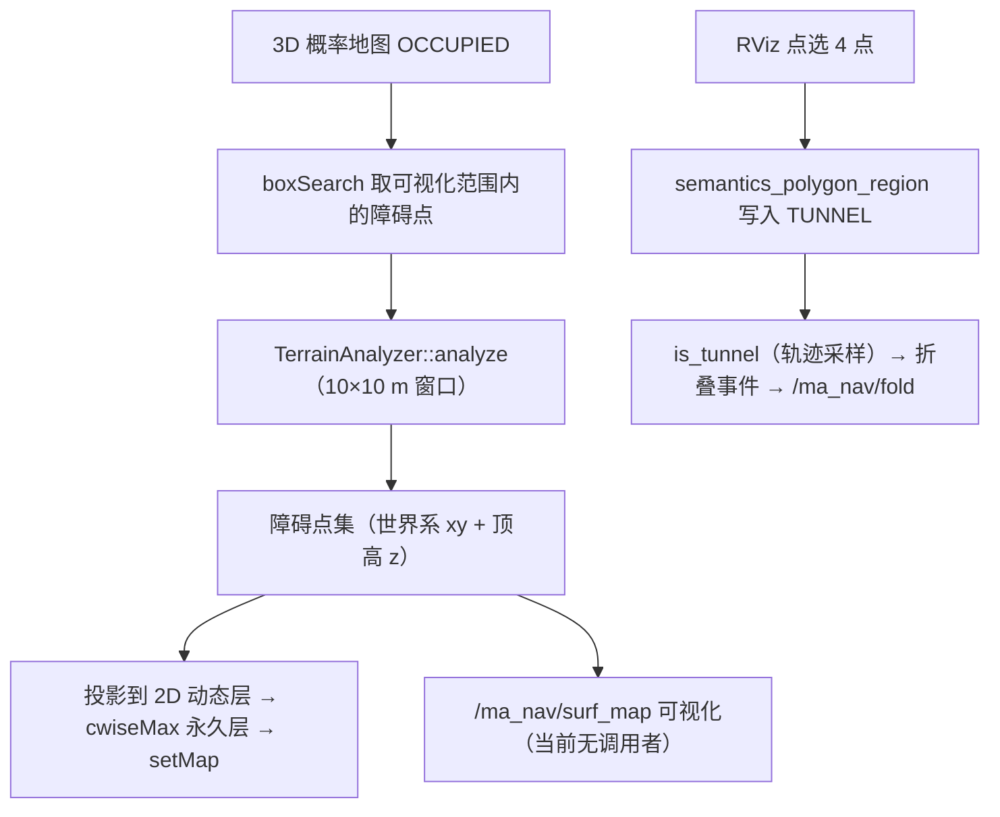
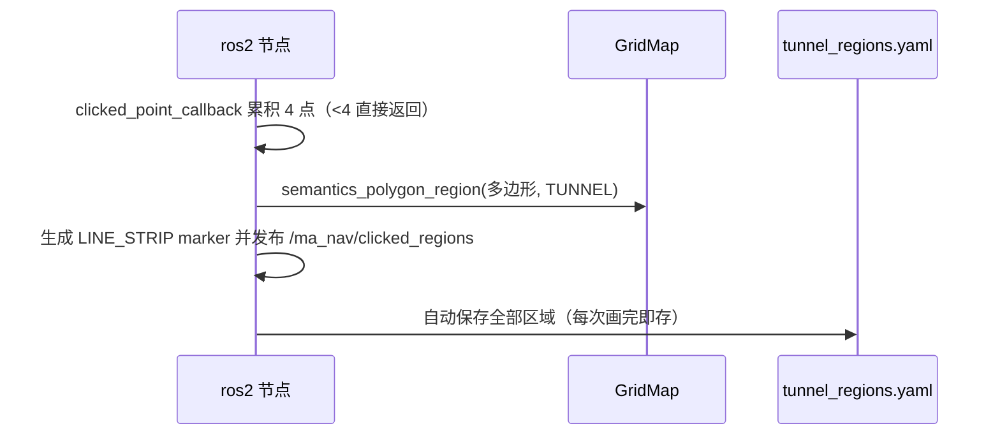

# 地形与隧道语义

> **阅读约定**：锚点 `路径:行号` 相对基线 `git_rev 8f98daee5bc7`。
> 【事实】代码里能直接读到；【推断】由事实推导、代码没直说（给出依据）；【待确认】两侧对不上。
> 本文是 map 算法思路的第 2 篇：第 1 篇讲**概率占据与滑窗**，本篇讲**怎么把 3D 体素变成「能不能走」，
> 以及怎么把「这里是不是隧道」变成云台折叠的决策依据**。

---

## 1 方案概述

| 项 | 内容 |
|---|---|
| 输入 | ①3D 概率地图中 `OCCUPIED` 的体素点（`src/map/include/map/ma_map.hpp:150`）；②RViz 点选的 4 点多边形（`src/ros2/src/ros2_node.cpp:493`） |
| 输出 | ①**可通行面（surf）**：窗口内的障碍点集，投影成 2D 动态障碍层（`src/map/include/map/ma_map.hpp:85-95`）；②**隧道语义**：2D 栅格上的 `TUNNEL` 标记（`src/map/include/map/grid_map.hpp:98-101`） |
| 消费方 | 规划侧读 2D 栅格做搜索；折叠链路读语义生成折叠事件（`src/ros2/src/ros2_node.cpp:314-321`） |
| 当前状态 | 地形分析**每帧执行**（`:80`）；前沿提取关闭（`config/map.yaml:11`）；ESDF 关闭（`:32`）；surf 可视化话题当前无调用者 |

**为什么要地形分析**：3D 概率地图只能回答「这一格是不是占据」。但机器人**能通过**的条件不是
「格子是自由的」，而是「这一格附近有足够连续的落脚面、上方有足够垂直间隙」——
台阶、斜坡边缘、桌腿之间的缝隙在体素层面都是「占据」，但对车体含义完全不同。
地形分析把**局部高度场**取出来，用两个几何判据（坡度突变、垂直间隙）重新判定可通行性。

**为什么要显式隧道语义**：隧道/涵洞与普通窄通道在点云上无法可靠区分（都要靠「顶」的存在判断），
而比赛场地里隧道位置是**已知先验**。与其让感知去猜，不如让操作者点选多边形写入地图，
再由同一份语义驱动两件事：①可视化给操作者确认；②生成云台折叠事件
（`src/ros2/src/ros2_node.cpp:522`、`:314-321`）。

## 2 核心思想

### 2.1 用「局部高度场」代替逐点占据

逐点判断无法表达「缝隙」。地形分析先把窗口内的占据点按 xy 分箱，只保留每箱的**最低点**（地面）
与**最高点**（墙/顶）（`src/map/src/terrain_analysis.cpp:33-41`），
之后的全部判据都建立在这两张高度图上。这样每格的计算量从「点数」降为 $O(1)$。

### 2.2 双判据：坡度突变 + 垂直间隙

只有「高差大」不足以判定障碍（斜坡也是高差大但可通行），所以用两条互补判据：
**邻域坡度**（判断垂直边/悬崖）与**内部垂直间隙**（判断顶与地面之间能否塞下车体）
（`src/map/src/terrain_analysis.cpp:85`、`:122`）。前者优先，命中即判障碍并跳过后者。

### 2.3 中值滤波抑制离群高度

最低点容易受噪声/地面反射影响，先对地面高度图做中值滤波再算坡度
（`src/map/src/terrain_analysis.cpp:45`）。中值而非均值：单个离群值不会改变中值，
因此不会凭空造出一个「悬崖」（`src/map/include/map/terrain_analysis.hpp:41-42`）。

### 2.4 隧道语义是**人工先验**，不是感知推断

点选多边形的代价是人工，收益是**语义绝对可靠**：不会因为点云缺失、遮挡或隧道内壁几何相似而误判，
也不需要为隧道训练/调参。语义存在独立的 `uint8_t` 缓冲里，与占据缓冲**解耦**
（`src/map/include/map/grid_map.hpp:240`），因此重规划/建图不会把标记冲掉。

### 2.5 一条因果链从语义走到云台

语义不直接控制云台，而是被**轨迹采样**消费：规划出轨迹后按时间采样，逐点查 `is_tunnel`，
得到「进入/退出隧道」的时间区间，再转成提前折叠、滞后展开的事件时间
（`src/ros2/src/ros2_node.cpp:883-902`、`:950-955`）。
这样做的好处是**折叠时机跟着轨迹走**：即使是同一条隧道，走的快慢不同，折叠时刻也不同。

## 3 数学建模

### 3.1 记号约定

| 记号 | 含义 | 取值来源 |
|---|---|---|
| $r$ | 地形分析网格分辨率（= 概率地图分辨率） | 0.1 m（`src/map/include/map/ma_map.hpp:25`） |
| $W_x,W_y$ | 分析窗口边长 | 取局部更新盒 xy = 10 m（`config/map.yaml:71`） |
| $K$ | 中值滤波核边长 | 5（`config/map.yaml:52`） |
| $h_{\min}(i,j),h_{\max}(i,j)$ | 箱内最低/最高点高度 | `src/map/src/terrain_analysis.cpp:39-40` |
| $\bar h(i,j)$ | 中值滤波后的地面高度 | `:45` |
| $\gamma(i,j)$ | 8 邻域地面最大高差（坡度代理量） | `:49-69` |
| $\theta_{step}$ | 台阶/墙体高差阈值 | 0.15 m（`config/map.yaml:53`） |
| $\theta_{steep}$ | 陡边阈值 | 0.17（`:55`） |
| $H_{robot}$ | 车体所需最小垂直间隙 | 0.3 m（`:54`） |
| $\Delta_{gap}$ | 箱内相邻高度最大间隙 | `:113-120` |
| $\mathcal{P}$ | 隧道多边形（世界系 xy 顶点序列） | `src/ros2/src/ros2_node.cpp:509` |
| $\mathcal{T}(i,j)$ | 语义标记（`NONE`/`TUNNEL`） | `src/map/include/map/grid_map.hpp:98-101` |
| $T_{fold},T_{unfold},M$ | 折叠时间、展开时间、裕量 | `src/ros2/src/ros2_node.cpp:318-320` |

### 3.2 窗口与网格化

窗口以机器人为中心、边长 $W$，为避免机器人连续运动时地形点亚网格抖动，
窗口原点**对齐到分辨率网格**（`src/map/src/terrain_analysis.cpp:283-286`）：

$$
o_x=\Big\lfloor\frac{p_x-W_x/2}{r}\Big\rceil r,\qquad
o_y=\Big\lfloor\frac{p_y-W_y/2}{r}\Big\rceil r
$$

格子数与索引/格心（`:288-291`、`:298-314`）：

$$
n_x=\Big\lceil\frac{W_x}{r}\Big\rceil,\quad n_y=\Big\lceil\frac{W_y}{r}\Big\rceil,\qquad
i=\Big\lfloor\frac{x-o_x}{r}\Big\rfloor,\quad j=\Big\lfloor\frac{y-o_y}{r}\Big\rfloor,\qquad
\mathbf{c}_{ij}=\Big(o_x+(i+\tfrac12)r,\;o_y+(j+\tfrac12)r\Big)
$$

【推断】按当前参数：$n_x=n_y=\lceil10/0.1\rceil=100$，即 **100×100 的窗口**；
落在外面的点直接丢弃（`:302-305`）。

### 3.3 高度场与中值滤波

$$
h_{\min}(i,j)=\min_{p\in\Omega_{ij}}p_z,\qquad
h_{\max}(i,j)=\max_{p\in\Omega_{ij}}p_z,\qquad
\Omega_{ij}=\varnothing\Rightarrow \text{NaN}
$$

【事实】两个极值在一次遍历里同时求出（`src/map/src/terrain_analysis.cpp:33-41`），
空箱保持 NaN 并在后续所有判据中被跳过（`:53`、`:79`、`:82`）。
$\bar h=\operatorname{median}_{K}(h_{\min})$（`:45`，核大小 $K$，仅统计非 NaN 邻居，见
`src/map/include/map/terrain_analysis.hpp:41-42`）。

### 3.4 陡边判据

$$
\gamma(i,j)=\max_{(u,v)\in\mathcal{N}_8(i,j)}\big\lvert \bar h(i,j)-\bar h(u,v)\big\rvert
$$

$$
\text{陡边}\iff \gamma(i,j)>\theta_{steep}
$$

【事实】8 邻域遍历与取最大见 `src/map/src/terrain_analysis.cpp:56-67`；
命中后**直接输出障碍并跳过间隙检查**（`:88-93`），输出点的高度取 $h_{\max}$（保留墙顶/悬崖顶高度）。

### 3.5 间隙判据

先做高差门控：若 $h_{\max}-\bar h\le\theta_{step}$，认为整箱几乎是平地，直接判可通行
（`src/map/src/terrain_analysis.cpp:96-97`）。否则把箱内高于 $\bar h-0.05$ 的高度排序，
求相邻高度的最大间隔：

$$
\Delta_{gap}=\max_{k}\big(z_{(k+1)}-z_{(k)}\big),\qquad z_{(k)}\in \operatorname{sort}\{p_z\mid p_z\ge \bar h-0.05\}
$$

$$
\text{不可通行}\iff \Delta_{gap}<H_{robot}\;\wedge\;h_{\max}>0.15
$$

【事实】0.05 的噪声过滤见 `src/map/src/terrain_analysis.cpp:106`，排序与最大间隔见 `:112-120`，
判据见 `:122-123`（其中 `0.15` 是**硬编码**、不是配置项，与 $\theta_{step}$ 数值相同但来源不同）。

### 3.6 输出点的定义

两种情况都输出**网格中心 xy 与箱内最高点 z**（`:89-91`、`:124-126`）：

$$
\mathbf{q}_{ij}=\Big(\mathbf{c}_{ij},\,h_{\max}(i,j)\Big)
$$

【待确认】头文件注释写的是「输出 z=0 可通行、z=1 不可通行」
（`src/map/include/map/terrain_analysis.hpp:32-36`），但实现输出的是**世界系高度**；
模块文档已把这条登记为「注释与实现不一致」（`docs/nav/map/模块设计说明.md:144`）。
实际消费方只用 xy（投影到 2D），z 仅用于可视化，因此当前不影响行为。

### 3.7 多边形栅格化与「点在多边形内」

写入语义时对**地图里每个栅格**做一次点在多边形内测试（`src/map/include/map/grid_map.hpp:122-133`）：

$$
\mathcal{T}(i,j)\leftarrow \text{TUNNEL}\quad\text{若 } \mathbf{c}_{ij}\in\mathcal{P}
$$

点在多边形内用**交叉数法（ray casting）**（`src/map/include/map/grid_map.hpp:219-231`）：

$$
\text{inside}\iff \#\Big\{(p_i,p_j)\ \Big|\ (p_{i,y}>y)\neq(p_{j,y}>y)\;\wedge\;
x<\frac{(p_{j,x}-p_{i,x})(y-p_{i,y})}{p_{j,y}-p_{i,y}}+p_{i,x}\Big\}\ \text{为奇数}
$$

【推断】按当前 2D 栅格参数（分辨率 0.05 m、范围 $x\in[-6,22]$、$y\in[-8,8]$，见
`config/map.yaml:60-64` 与 `src/map/include/map/grid_map.hpp:58-62`），
栅格数约 $560\times320=179\,200$；即**每写入一个多边形都要遍历约 18 万格**。

### 3.8 隧道区间与折叠事件

轨迹在**局部时间轴**上等间隔采样，逐点查语义（`src/ros2/src/ros2_node.cpp:883-898`）：

$$
\text{inside}(t)=\mathcal{T}\big(\operatorname{index}(s(t))\big)=\text{TUNNEL},\qquad
t\in\{0,\Delta t,2\Delta t,\dots,T_{dur}\}
$$

连续 `inside` 段构成区间 $[t_{entry},t_{exit}]$；若采样结束时仍在隧道内，区间右端取轨迹总时长
（`:900-902`）。相邻区间间隔小于「折叠+展开+两倍裕量」时合并（`:935-945`）：

$$
t_{entry}^{(k+1)}-t_{exit}^{(k)}<T_{fold}+T_{unfold}+2M
\;\Longrightarrow\;\text{合并为一个连续折叠段}
$$

每个（合并后的）区间的折叠/展开时刻（`:950-959`）：

$$
t_{fold}=\max\big(0,\;t_{entry}-T_{fold}-M\big),\qquad
t_{unfold}=t_{exit}+M
$$

事件按时间排序，并按「状态是否变化」压缩掉连续同状态事件（`:962-973`）。

## 4 工程实现

### 4.1 地形链（每帧）

| 步骤 | 符号 / 规则 | 锚点 |
|---|---|---|
| 1 组装配置 | `kernel_size`/`max_step_height`/`robot_height`/`steep_threshold` 从 `Config` 拷贝，窗口边长取局部更新盒 xy | `src/map/include/map/ma_map.hpp:20-28` |
| 2 取障碍点 | `boxSearch(机器人 ± visualization_range/2, OCCUPIED)` | `src/map/include/map/ma_map.hpp:146-150` |
| 3 分析 | `TerrainAnalyzer::analyze` | `src/map/src/terrain_analysis.cpp:8` |
| 4 动态层清零 | 规划模式下每帧清 `dynamic_2d_occ_` | `src/map/include/map/ma_map.hpp:81-83` |
| 5 投影到 2D | 逐点 `posToIndex` 并置 1（越界丢弃） | `src/map/include/map/ma_map.hpp:85-93` |
| 6 融合并写回 | `dynamic.cwiseMax(global)` → `GridMap::setMap` | `src/map/include/map/ma_map.hpp:94-95` |

### 4.2 隧道语义写入链

| 步骤 | 锚点 |
|---|---|
| 累积点与 <4 门控 | `src/ros2/src/ros2_node.cpp:494`、`:504-506` |
| 多边形与写语义（带地图锁） | `src/ros2/src/ros2_node.cpp:509-523`（写入调用 `:522`） |
| marker 闭合并发布 | `src/ros2/src/ros2_node.cpp:543`、`:550` |
| 自动保存 | `src/ros2/src/ros2_node.cpp:553` → `:742-776` |

### 4.3 语义载入链与存储格式

| 项 | 内容 | 锚点 |
|---|---|---|
| 存储格式 | `regions:` 序列，每项含 `name` 与 `points`（每点 `[x,y,z]`） | `src/ros2/src/ros2_node.cpp:743-761` |
| 写失败处理 | 文件打不开只打错误日志并返回 | `src/ros2/src/ros2_node.cpp:764-769` |
| 读入 | `YAML::LoadFile` 抛异常只告警；无 `regions` 只告警 | `src/ros2/src/ros2_node.cpp:780-789` |
| 重建语义 | 逐区域再调 `semantics_polygon_region` | `src/ros2/src/ros2_node.cpp:825-831` |
| 调用时机 | 构造期、非建图模式（且该分支被写了两遍） | `src/ros2/src/ros2_node.cpp:122-128` |
| 存储路径 | `ros2.tunnel_regions_path` = `/home/xyt/map/src/MA_Nav/maps/tunnel_regions.yaml` | `config/planner.yaml:14` |

【事实】该路径是**绝对路径**，且仓库当前**没有 `maps/` 目录**（`ls maps/` 失败）——
因此现在点选完 4 点时自动保存会走到「文件打不开」分支，只留一条错误日志。

### 4.4 `is_tunnel` 消费链（语义 → 云台）

| 步骤 | 符号 | 锚点 |
|---|---|---|
| 1 生成事件 | `generate_fold_events(样条轨迹, 栅格, 折叠/展开时间, 裕量)` | `src/ros2/src/ros2_node.cpp:314-321` |
| 2 语义区间 | `detect_tunnel_intervals` 采样轨迹查 `is_tunnel` | `src/ros2/src/ros2_node.cpp:865-902` |
| 3 合并/生成/压缩 | merge_gap → 折叠/展开时刻 → 排序压缩 | `src/ros2/src/ros2_node.cpp:935-973` |
| 4 新轨迹对齐 | 跳过已过去事件，把「应有状态」写进记账变量 | `src/ros2/src/ros2_node.cpp:325-337` |
| 5 运行时消费 | 控制回调按跟踪时间排空事件并发布 `/ma_nav/fold` | `src/ros2/src/ros2_node.cpp:197-216`（发布 `:206`） |

【事实】第 4 步里**补发指令的那行被注释掉了**（`src/ros2/src/ros2_node.cpp:336`），
只更新 `current_fold_state_`：若新轨迹的应有状态与已下发状态不同，指令与记账会静默发散——
模块文档已把它列为风险（`docs/nav/ros2/模块设计说明.md` 的折叠相关条目）。

## 5 关键参数与细节

| 参数 | 当前值 | 作用 | 改动影响 |
|---|---|---|---|
| `terrain.kernel_size` | 5（`config/map.yaml:52`） | 地面高度中值滤波核 | 变大更平滑但会抹掉窄台阶；变小对噪声敏感 |
| `terrain.max_step_height` | 0.15 m（`:53`） | 高差门控：低于它直接判可通行 | 调大更宽松（更多「平地」），可能放过台阶 |
| `terrain.robot_height` | 0.3 m（`:54`） | 所需最小垂直间隙 | 调小更宽松；这是「能否钻过」的直接阈值 |
| `terrain.steep_threshold` | 0.17（`:55`） | 陡边判定阈值（注释建议与上者相近） | 调小会把斜坡判成障碍；调大可能漏掉悬崖 |
| 硬编码 `0.15` | `src/map/src/terrain_analysis.cpp:123` | 间隙判据的附加高度门控 | **不是参数**；改名/参数化需谨慎（它与 `max_step_height` 数值相同但来源独立） |
| 硬编码 `0.05` | `src/map/src/terrain_analysis.cpp:106` | 高度噪声过滤下限 | 地面估计偏差大时可能过滤掉真实结构 |
| `rog_map.resolution` | 0.1 m（`config/map.yaml:3`） | 地形网格分辨率（直接复用） | 与概率地图同步变化，影响窗口格数与算力 |
| `raycasting.local_update_box` | [10,10,4] m（`:71`） | 地形窗口边长取自它 | 窗口变小→地形覆盖不足；变大→算力上升 |
| `grid_map.resolution` | 0.05 m（`:64`） | 2D 规划栅格分辨率 | 决定语义栅格化代价（约 18 万格/次） |
| `grid_map.x/y_left/right` | 6/22/8/8 m（`:60-63`） | 2D 栅格边界（原点向四方延伸） | 决定语义可标记范围；出界点被忽略 |
| `visualization.range` | [100,60,4] m（`:40`） | 取障碍点的搜索盒（实际由窗口裁剪） | 过小会导致窗口内点不足 |
| `esdf.enable` | false（`:32`） | 是否启用距离场 | 2D 侧另有独立距离场（`GridMap::getDistance`），与此开关无关 |
| `frontier_extraction_en` | false（`:11`） | 是否维护前沿层 | 与隧道语义无关，但共用 `resetCell` 回调 |

## 6 已知限制与优化方向

| # | 限制 | 证据 | 影响 / 方向 |
|---|---|---|---|
| 1 | 头注释与实现不一致（z=0/1 vs 世界高度） | `src/map/include/map/terrain_analysis.hpp:32-36` vs `src/map/src/terrain_analysis.cpp:89-91` | 读者容易误解输出语义；建议改成「z = 障碍顶高」 |
| 2 | 两处硬编码阈值（0.15 / 0.05） | `src/map/src/terrain_analysis.cpp:123`、`:106` | 调参时必须改代码；建议参数化并纳入 `map.yaml` |
| 3 | 多边形栅格化是全图扫描 | `src/map/include/map/grid_map.hpp:124-132` | 每次写标记约 18 万格 × 顶点数；可按多边形包围盒裁剪 |
| 4 | 语义不随全局地图存取 | 全局地图只存 PGM/YAML 占据（`src/ros2/src/ros2_node.cpp:715-740`），语义只在 `tunnel_regions.yaml` | 两份文件需同时维护；建议把语义并入地图文件或校验两者一致 |
| 5 | 自动保存当前必失败 | 路径为绝对路径且 `maps/` 目录不存在（`config/planner.yaml:14`；`src/ros2/src/ros2_node.cpp:764-769`） | 点选结果只在内存中有效；下次启动即丢失。修法：建目录或改成相对配置路径 |
| 6 | 窗口以机器人为中心、无前瞻 | `src/map/src/terrain_analysis.cpp:283-286` | 高速时前方地形来不及更新；可把窗口中心沿速度方向前移 |
| 7 | 隧道多边形只有 xy、没有高度范围 | `semantics_polygon_region` 只按 xy 判多边形内外，缓冲里没有高度维度（`src/map/include/map/grid_map.hpp:122-133`） | 【推断】同一 xy 上任意高度都算隧道；若隧道上下有可通行夹层会误判 |
| 8 | 折叠状态补发被注释 | `src/ros2/src/ros2_node.cpp:336` | 新轨迹切换到「本应已折叠」时不会立即补发指令（跨模块风险，见 ros2 模块文档） |
| 9 | surf 可视化当前无调用者 | `src/ros2/src/ros2_node.cpp` 无 `visualizeSurfMap` 调用；`src/ros2/include/ros2/misc/visualizer.hpp:905` 定义 | `/ma_nav/surf_map` 永不发布，地形结果只能靠 2D 栅格间接观察 |
| 10 | 旧版 `analyze` 实现整段被注释保留 | `src/map/src/terrain_analysis.cpp:132` 起 | 约 140 行死代码，干扰阅读；建议随版本清理 |
| 11 | 语义标记没有清除入口 | `src/map/include/map/grid_map.hpp:136-138` 有 `clear_all_markers`，但无调用者 | 点错多边形只能重启节点；建议加一个清空服务 |

**优化优先级建议**：先修「自动保存必失败」（限制 5，一行配置或建目录即可）与「注释/语义口径」（限制 1），
它们直接影响可用性与可读性；再做多边形栅格化的包围盒裁剪（限制 3，纯局部优化）；
语义随地图存取（限制 4）与隧道高度范围（限制 7）属设计变更，需与 ros2、planner 一起评估。
