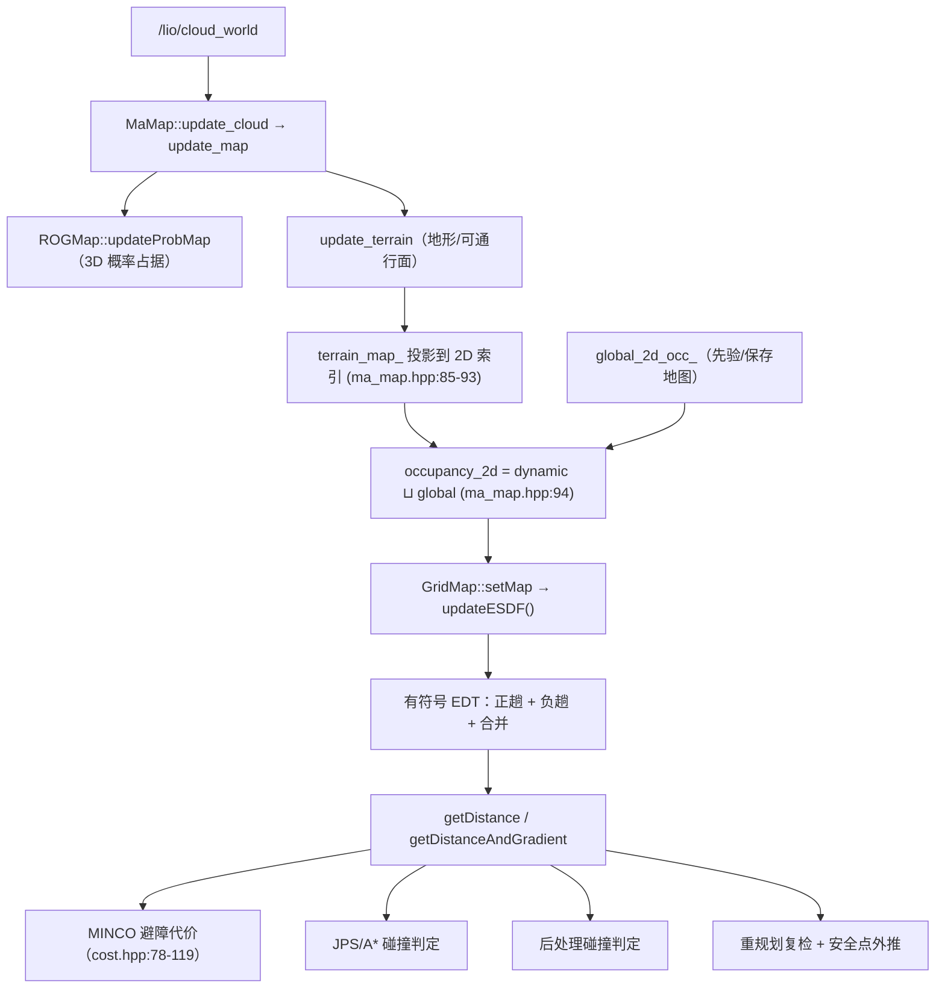

# 03 ESDF 距离场与避障梯度

> **一句话结论**【事实】：本项目里有**两套 ESDF**——3D 的 `rog_map::ESDFMap`（`src/map/include/map/3d_occ_map/esdf_map.h:35`）与 2D 的 `grid_map::GridMap` 有符号距离缓冲（`src/map/include/map/grid_map.hpp:239`）。
> **当前 3D ESDF 是关闭的**（`config/map.yaml:32`），规划链路真正消费的是 **2D 那套**（经 `GridMapESDF` 适配器注入优化器）。
> 因此「MINCO 为什么还能避障」的答案不是「3D ESDF 梯度」，而是「**2D 有符号距离场 + 安全距离软约束 + 搜索/后处理的硬阈值**」。

---

## 1 方案概述

| 项 | 3D ESDF（未启用） | 2D ESDF（在用） |
|---|---|---|
| 实现 | `rog_map::ESDFMap`（继承 `CounterMap`），`src/map/include/map/3d_occ_map/esdf_map.h:35` | `grid_map::GridMap::esdf_buffer_` + `updateESDF()`，`src/map/include/map/grid_map.hpp:239`、`src/map/src/grid_map.cpp:200` |
| 距离语义 | 有符号，占据内为负（`src/map/src/esdf_map.cpp:224-235`） | 有符号，占据内为负（`src/map/src/grid_map.cpp:262-266`） |
| 分辨率 | `rog_map.esdf.resolution = 0.3`（`config/map.yaml:33`） | `rog_map.grid_map.resolution = 0.05`（`config/map.yaml:64`） |
| 更新范围 | 里程计附近局部盒 `[15,15,3]` m（`config/map.yaml:35`） | 全图重算（`src/map/src/grid_map.cpp:55-57`） |
| 开关 | `rog_map.esdf.enable = false`（`config/map.yaml:32`） | 无开关：2D 占据一变就重算（`src/map/src/grid_map.cpp:55`） |
| 消费方 | **无**（创建/更新/可视化都被开关或 `#ifdef` 关掉） | 优化器避障代价、搜索/后处理碰撞判定、重规划安全点外推 |

【事实】3D ESDF 的创建与更新都被 `if (cfg_.esdf_en)` 包住：`src/map/src/prob_map.cpp:55`、`src/map/src/prob_map.cpp:344`、`src/map/src/rog_map.cpp:71`；唯一可视化出口也在 `#ifdef ESDF_MAP_DEBUG` 内（`src/ros2/include/ros2/misc/visualizer.hpp:1377-1383`）。

## 2 核心思想

**2.1 把「碰没碰」变成「离多远」。** 布尔占据图只能回答是否碰撞；距离场给出连续量 $d(p)$，于是避障可以写成**可微代价**，用梯度把轨迹推离障碍（`src/planner/traj_optimize/include/traj_optimize/ma_spline_opt/cost.hpp:78-119`）。

**2.2 有符号让一个标量表达三态。** 自由空间取正、障碍内部取负，于是「$d > d_{safe}$ 安全 / $0<d<d_{safe}$ 太近 / $d<0$ 已侵入」可以只用一个数判断（`src/map/include/map/grid_map.hpp:69-71`）。

**2.3 软约束与硬阈值分工。**
- **硬阈值**：搜索（`src/planner/path_planning/src/search/jps.cpp:59`、`:174`）、后处理（`src/planner/path_planning/src/post_processing.cpp:53`）、重规划复检（`src/planner/replan/src/fsm_replanner.cpp:196`）只接受 $d \ge 0.35$ 的点。
- **软约束**：优化器允许轨迹短暂进入安全带内，用代价把它推出去（`src/planner/traj_optimize/include/traj_optimize/ma_spline_opt/cost.hpp:81-86`）。这正是参考文档里「硬约束在狭窄通道过于保守」的动机（`docs/nav/开源参考/RM2026哈工大(威海)哨兵导航方案.md:183`）。

**2.4 为什么是 2D。** 底盘是全向 2D 运动（`src/planner/traj_optimize/include/traj_optimize/ma_spline_opt/problem.md:7`），高度方向的信息由**地形图 + 隧道语义**承担，而不是三维距离场（见 [map/02](./02-地形与隧道语义.md)）。因此 2D 场足以支撑「平面上离障碍多远」，低矮隧道另行处理。

## 3 数学建模

### 3.1 记号约定

| 记号 | 含义 |
|---|---|
| $r$ | 栅格分辨率（2D 场 $r=0.05$ m） |
| $i=(i_x,i_y)$ | 栅格索引；`toAddress` 线性化（`src/map/include/map/grid_map.hpp:200-202`） |
| $\mathcal{O}$ | 占据栅格集合（`occ_buffer_[i]=1`） |
| $d(p)$ | 点到最近占据栅格中心的欧氏距离 |
| $\phi(p)$ | 有符号距离（自由为正、占据为负） |
| $d_{safe}$ | 安全距离阈值（$0.35$ m） |
| $w_{obs}$ | 避障代价权重（两阶段 $800 / 8000$） |

### 3.2 有符号距离的定义

$$d(p)=\min_{q\in\mathcal{O}}\lVert p-q\rVert,\qquad
\phi(p)=\begin{cases}+d(p),& p\notin\mathcal{O}\\ -d(p),& p\in\mathcal{O}\end{cases}$$

【事实】2D 实现把「内部距离」也做了一遍距离变换，再用 $\phi=-d_{in}+r$ 拼出负值区（`src/map/src/grid_map.cpp:257-267`），其中 `:263` 就是 `-neg_dist + resolution`：**占据格的 $\phi$ 落在 $(-r,0]$**，所以「侵入深度」以不超过一个格为起点。

### 3.3 2D 距离变换：可分离的抛物线下包络

二维精确 EDT 不需要 $O(N^2)$ 搜索。对平方距离做一维分解：

$$D(i_x,i_y)=\min_{j}\Big[(i_x-j)^2+f(j,i_y)\Big],\qquad f(j,i_y)=\min_{k}(i_y-k)^2+\mathbb{1}[\,(j,k)\in\mathcal{O}\,]\cdot 0+\infty$$

一维内层即**下包络**（Felzenszwalb–Huttenlocher）：

$$D(q)=\min_{v}\big[(q-v)^2+f(v)\big]$$

【事实】代码用 `fillESDF` 维护抛物线族的下包络（`src/map/include/map/grid_map.hpp:166-198`，取交点 `s` 并弹出被支配的 $v$，再从左到右取值），先沿 $y$、再沿 $x$ 两趟完成二维变换（`src/map/src/grid_map.cpp:209-229`），最后乘以 $r$ 转成米（`:224`）。**3D 版本用同一函数沿三轴各做一趟**（`src/map/src/esdf_map.cpp:104-160`）。

### 3.4 三线性插值与梯度

【事实】2D 查询在最近 2×2 格上做双线性插值（`src/map/src/grid_map.cpp:77-88`），梯度由同一组值做中心差分（`src/map/src/grid_map.cpp:126-128`）：

$$\nabla d \approx \Big(\frac{\partial d}{\partial x},\frac{\partial d}{\partial y}\Big),\qquad
\frac{\partial d}{\partial y}\approx\frac{v_1-v_0}{r}$$

【事实】3D 版本的 `getDistance` 直接取所在格的值、**不做插值**（`src/map/src/esdf_map.cpp:71-77`）；它另提供三线性插值的 `evaluateEDT`/`evaluateFirstGrad`/`evaluateSecondGrad`（`src/map/src/esdf_map.cpp:427-462`、插值实现 `:463-496`），但**全仓库没有调用点**。

### 3.5 避障软约束代价

优化器对积分采样点 $p$ 施加：

$$c_{obs}(p)=w_{obs}\cdot \mathrm{SL1}\big(d_{safe}-d(p)\big)$$

其中 $\mathrm{SL1}$ 是平滑 L1（$\varepsilon=10^{-2}$ 分段三次/线性，`src/planner/traj_optimize/include/traj_optimize/ma_spline_opt/cost.hpp:30-54`），只惩罚 $d<d_{safe}$；梯度按链式法则：

$$\frac{\partial c_{obs}}{\partial p}=-w_{obs}\,\mathrm{SL1}'\big(d_{safe}-d(p)\big)\,\nabla d(p)$$

【事实】代码即 `gp.head<2>() += w_obs * df * (-1.0) * grad_orth`（`src/planner/traj_optimize/include/traj_optimize/ma_spline_opt/cost.hpp:119`），注意梯度用的是 `grad_orth` 而非原始 $\nabla d$。

### 3.6 正交投影 + 梯度增强

设速度方向单位切向 $t=v/\lVert v\rVert$，先把梯度中沿运动方向的分量投影掉：

$$g_\perp=g-(g\cdot t)\,t,\qquad \lVert g_\perp\rVert<\kappa=0.5\ \Rightarrow\ \tilde g=\frac{g_\perp}{\lVert g_\perp\rVert}\sqrt{\lVert g_\perp\rVert}$$

退化（$\lVert g_\perp\rVert\le 10^{-6}$）时改用 $\tilde g=\kappa\,\hat g$。【事实】三段逻辑分别在 `src/planner/traj_optimize/include/traj_optimize/ma_spline_opt/cost.hpp:98-102`、`:106-109`、`:110-117`；作者注释标明这一手法「参考 minco」（`src/planner/traj_optimize/include/traj_optimize/ma_spline_opt/cost.hpp:90`）。
【推断】目的：狭窄通道里原始梯度与运动方向几乎共线，直接使用会让代价沿轨迹方向忽大忽小（震荡）；切向投影 + 开方整形把修正集中在**横向**，与 `docs/nav/开源参考/RM2025中科大导航.md:237` 讨论的「狭窄地形梯度震荡」是同一问题。

### 3.7 3D 局部 EDT 的增量结构

【事实】3D 版本每次只更新里程计附近的盒子（`src/map/src/esdf_map.cpp:96-102`）：

$$\mathcal{B}=\big[p_{odom}-h,\ p_{odom}+h\big]\cap\mathcal{M},\qquad h=\big\lfloor \text{local\_update\_box}/(2r)\big\rfloor$$

盒子外沿用上一次的距离值；`resetOneCell` 是**空实现**（`src/map/src/esdf_map.cpp:250-251`），即**不做单元级增量修复**，靠「每次整盒重算」保证一致性。这与参考实现的「按需快照」思路一致（`docs/nav/开源参考/RM2026哈工大(威海)哨兵导航方案.md:189`），只是我们连快照也关掉了。

## 4 工程实现

### 4.1 2D 距离场的数据流

| 环节 | 代码位置 | 说明 |
|---|---|---|
| 2D 占据生成 | `src/map/include/map/ma_map.hpp:85-95` | 地形点按 $x,y$ 投影；`occupancy_2d = dynamic_2d_occ_.cwiseMax(global_2d_occ_)` |
| **未做膨胀** | `src/map/include/map/ma_map.hpp:96` | `//grid_map_ptr_->inflate(0.02);` 被注释；膨胀函数本体存在（`src/map/src/grid_map.cpp:166-199`） |
| 距离变换 | `src/map/src/grid_map.cpp:200-269` | 正趟（占据为 0）→ 负趟（自由为 0）→ 合并成有符号值 |
| 查询 | `src/map/src/grid_map.cpp:60-89`、`:91-131` | 双线性值 + 中心差分梯度 |
| 注入优化器 | `src/planner/replan/src/fsm_replanner.cpp:92-93` | `GridMapESDF grid_map_esdf(grid_map); ma_opt_.set_esdf_interface(&grid_map_esdf);` |
| 适配器 | `src/planner/traj_optimize/include/traj_optimize/grid_map_esdf.hpp:27-44` | 实现 `getDistance/getGradient/isInside` 三件套 |
| 接口定义 | `src/planner/traj_optimize/include/traj_optimize/esdf_Interface.hpp:21-40` | CRTP 抽象，要求「自由为正、障碍为负」 |
| 优化器持有方式 | `src/planner/traj_optimize/include/traj_optimize/ma_spline_opt/traj_optimizer.h:29-31` | 只存裸指针 ⇒ 适配器必须活过整个 `optimize()` |
| 代价装配 | `src/planner/traj_optimize/include/traj_optimize/ma_spline_opt/traj_optimizer.h:292-295`、`:353-357` | 两阶段分别把 `safe_distance`、`weight_obstacle` 灌进积分代价 |

### 4.2 硬阈值判定点（不依赖优化器）

| 位置 | 判定 | 锚点 |
|---|---|---|
| JPS 格枚举 | `map_.getDistance(center) < safe_threshold_` → 该格视为阻挡 | `src/planner/path_planning/src/search/jps.cpp:59` |
| JPS 点检查 | 同上（带缓存） | `src/planner/path_planning/src/search/jps.cpp:174` |
| A\* 点检查 | 同上 | `src/planner/path_planning/src/search/astar.cpp:117` |
| 后处理 | `map_.getDistance(pos) < params_.safe_threshold` | `src/planner/path_planning/src/post_processing.cpp:53` |
| 重规划路径复检 | 用**更松**的 `hard_clearance = max(0.05, 0.2·safe_threshold)` 抽样检查 | `src/planner/replan/src/fsm_replanner.cpp:33`、`:196` |
| 安全点外推 | 沿 $\nabla d$ 把起点/终点推出安全带，最多 200 次、累计 1.5 m | `src/planner/replan/src/fsm_replanner.cpp:245-267` |

### 4.3 边界语义

【事实】`GridMap::getDistance` 对**图外点**返回 `max`（`src/map/src/grid_map.cpp:61`），而 `isCollision` 对图外点返回 `false`（`:137-139`）——即**图外不判碰撞**；与之相反，`isOccupied` 对图外索引返回 `true`（`src/map/include/map/grid_map.hpp:84-86`）。三处口径不同，使用距离场时必须自己明确「图外」算什么。

## 5 关键参数与细节

| 参数 | 当前值 | 作用 | 影响 |
|---|---|---|---|
| `rog_map.esdf.enable` | false | 3D ESDF 总开关 | 关：无 3D 距离/梯度；开：每次更新花钱在 0.3 m 分辨率的局部盒上 |
| `rog_map.esdf.resolution` | 0.3 m | 3D 场分辨率 | 注释要求「必须 ≥ 占据分辨率 0.1」（`config/map.yaml:33`）；越细越准越慢 |
| `rog_map.esdf.local_update_box` | [15,15,3] m | 3D 每次重算的盒子 | 决定单帧 EDT 的规模；注释写明「增大以匹配地图」（`config/map.yaml:35`） |
| `rog_map.resolution` | 0.1 m | 3D 占据分辨率 | 与 ESDF 分辨率解耦（0.1 vs 0.3） |
| `rog_map.inflation_resolution` | 0.1 m | 膨胀图分辨率 | 膨胀图服务于概率/地形，不参与 2D 距离场 |
| `rog_map.grid_map.resolution` | 0.05 m | **2D 场分辨率** | 比 3D 细 2 倍、比 ESDF 细 6 倍；决定梯度平滑度与 EDT 开销 |
| `grid_map.x/y` 范围 | x∈[-6,22]、y∈[-8,8]（`config/map.yaml:60-63`） | 2D 场地尺寸 | 28 m × 16 m ⇒ 560×320 = 17.9 万格，全量 EDT 的规模 |
| `safe_threshold`（搜索） | 0.35 m | 搜索/后处理/重规划硬阈值 | 决定「可通行」的定义；也是安全点外推的目标距离 |
| `safe_distance`（优化） | 0.35 m | 软约束安全带 | **与 `safe_threshold` 是两个独立键、当前同值** |
| `stage1/2.weight_obstacle` | 800 / 8000 | 避障代价权重 | 二阶段高 10 倍：先粗后精 |
| `integral_num_steps` | 8 | 每段时间积分离散点数 | 值越小越省，但软约束更易被「钻空子」 |
| 重规划 `hard_clearance` | max(0.05, 0.07)=0.07 m | 复用旧轨迹的复检阈值 | 比搜索阈值松 5 倍：可能放行一条 0.07 m 余量的旧轨迹 |

**细节 1**：2D 场每次 `setMap` 且**内容有变化**时才重算（`src/map/src/grid_map.cpp:42-58`），因此静止时无开销。【事实】

**细节 2**：优化器两阶段用的是同一个适配器与同一份 2D 场，只是权重与迭代预算不同（`src/planner/traj_optimize/include/traj_optimize/ma_spline_opt/traj_optimizer.h:292-295`、`:353-357`）。

**细节 3**：`check_trajectory_collision`（`src/planner/traj_optimize/include/traj_optimize/ma_spline_opt/traj_optimizer.h:145-160`，内部 `esdf->getDistance(p) < safe_distance`）**全仓库无调用点**：所谓「输出后校验」并不存在，安全性由搜索/后处理与重规划复检负责。【事实】

## 6 已知限制与优化方向

1. **3D ESDF 关闭 ⇒ 没有三维距离信息。【事实】** 低矮隧道在几何上与普通障碍等价，只能靠隧道语义 + 云台折叠规避（`src/map/include/map/grid_map.hpp:140-145`、`src/ros2/src/ros2_node.cpp:315`）。
2. **2D 场是高度无关投影。【事实】** 投影只看 $x,y$（`src/map/include/map/ma_map.hpp:86-91`），高障碍与地面小凸起同权。
3. **没有膨胀，安全裕度全靠阈值。【事实】** 膨胀函数存在但被注释（`src/map/include/map/ma_map.hpp:96`）。若开启 0.02 m 膨胀，可通行区域会略缩小，但能减少「贴边」轨迹。
4. **全量 EDT。【事实】** 2D 侧每次变化重算整图（`src/map/src/grid_map.cpp:55-57`），而 3D 侧已有局部盒机制。**优化方向【推断】**：把 3D 的局部盒思路（`src/map/src/esdf_map.cpp:96-102`）搬到 2D，或只在机器人附近维护局部场。
5. **概率/地形置信度未进入距离。【事实】** 2D 占据是二值的（`occ_buffer_`），遗忘概率与地形高度不参与加权。【推断】可将概率映射为「等效膨胀半径」。
6. **梯度退化处理是启发式。【待确认】** `kThreshold = 0.5`、开方整形与「参考 minco」的具体出处没有文档（`src/planner/traj_optimize/include/traj_optimize/ma_spline_opt/cost.hpp:90-117`），阈值来源需作者确认。
7. **两个同值键的口径风险。【待确认】** `safe_threshold`（`config/planner.yaml:24`）与 `safe_distance`（`:47`）当前都是 0.35，但分别控制硬阈值与软约束；只改一个会造成「搜索认为安全、优化认为不安全」的错位。
8. **3D 梯度 API 无人使用。【事实】** `evaluateEDT/evaluateFirstGrad/evaluateSecondGrad` 只有定义（`src/map/src/esdf_map.cpp:427-462`）。若将来启用 3D ESDF，需要先补调用方与插值口径。
9. **图外语义不统一【待确认】**：`getDistance` 返回 max、`isCollision` 返回 false、`isOccupied` 返回 true（见 4.3），调用者必须自行约定。

---

> 基线：代码行号对应 `git_rev = 8f98daee5bc7`。事实锚点可直接跳转；标【推断】的是由事实推导但代码未直说的部分；标【待确认】的需作者确认。
