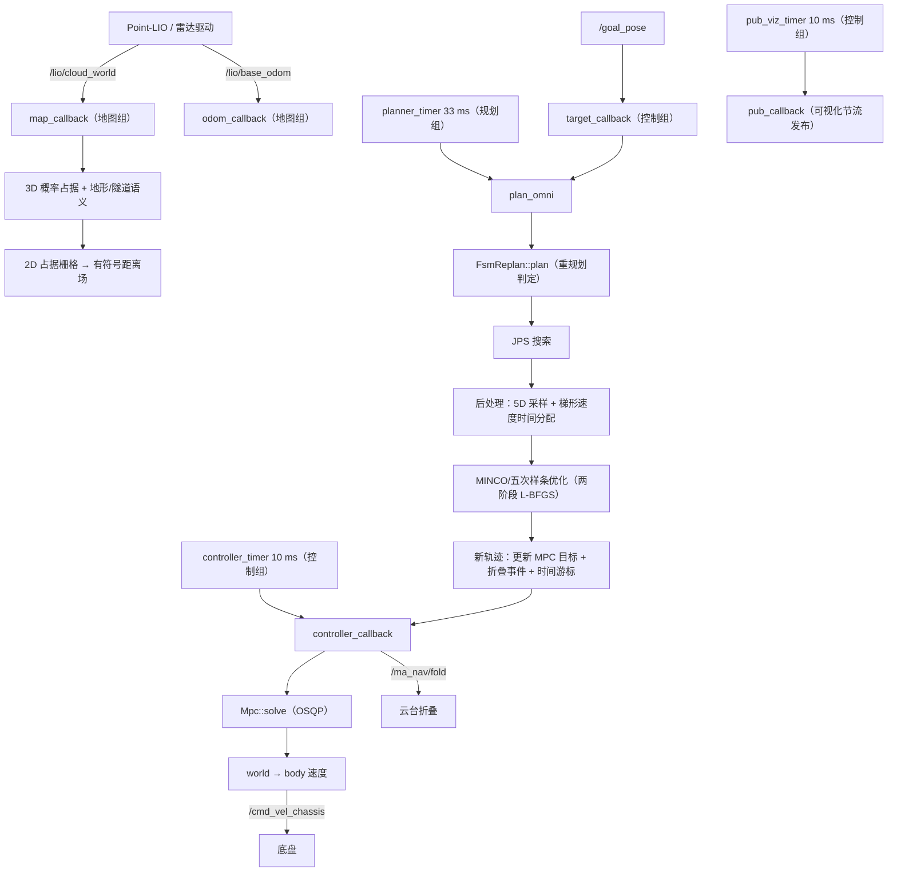

# 01 导航框架与数据流

> **一句话结论**【事实】：MA_Nav 是**单进程、单节点、单线程**的顺序流水线——
> 点云/里程计进地图，**33 ms** 的规划节拍里跑「JPS 搜索 → 后处理 → MINCO 五次样条优化」，
> **10 ms** 的控制节拍里跑 4 状态 MPC，重规划 FSM 插在搜索之前；
> 主循环是 `rclcpp::spin_some`，所以三个互斥回调组只是**分组声明**，实际顺序执行。

---

## 1 方案概述

| 环节 | 周期 | 入口 | 输出 | 锚点 |
|---|---|---|---|---|
| 建图 | 点云到达 | `map_callback` | 3D 概率占据 + 2D 栅格 | `src/ros2/src/ros2_node.cpp:429` |
| 定位 | 里程计到达 | `odom_callback` | 当前位姿/速度 | `src/ros2/src/ros2_node.cpp:394` |
| 目标 | 目标到达 | `target_callback` | 目标 + 20 s 计时起点 | `src/ros2/src/ros2_node.cpp:459` |
| 规划 | 33 ms | `plan_omni` | 轨迹 + 折叠事件 | `src/ros2/src/ros2_node.cpp:248` |
| 控制 | 10 ms | `controller_callback` | `/cmd_vel_chassis` | `src/ros2/src/ros2_node.cpp:130` |
| 可视化 | 10 ms（按地图配置节流） | `pub_callback` | 24 个 `/ma_nav/*` 话题 | `src/ros2/src/ros2_node.cpp:438` |

| 模块 | 一句话职责 | 算法文档 |
|---|---|---|
| map | 点云 → 带概率的 3D 占据 + 2D 栅格 + 地形/隧道语义 | [map/01](../map/01-概率占据建图与滑窗.md)、[map/02](../map/02-地形与隧道语义.md)、[map/03](../map/03-ESDF距离场与避障梯度.md) |
| path_planning | JPS/A\* 搜索 + 5D 采样 + 梯形速度时间分配 | [planner/02](./02-全局搜索JPS与A星.md)、[planner/03](./03-路径后处理与时间分配.md) |
| traj_optimize | 路径 → 五次样条（MINCO 思路），两阶段 L-BFGS | [planner/04](./04-轨迹优化MINCO与五次样条.md) |
| controller | 4 状态线性 MPC（x,y,vx,vy / ax,ay） | [planner/05](./05-MPC控制器.md) |
| replan | 何时重规划、起终点外推、失败判定 | [planner/06](./06-重规划策略.md) |
| ros2 | 唯一 ROS 集成层：接口、节拍、折叠、地图存取 | 本文 |

## 2 核心思想

**2.1 分层降维：几何解 → 时间解 → 光滑解 → 闭环解。**【事实】路径分段处理，每层只解决一个问题：栅格搜索给**拓扑/几何**可行解（`src/planner/path_planning/src/search/jps.cpp:192`），后处理给**时间**参数化（`src/planner/path_planning/src/post_processing.cpp:121`），优化器给**光滑且动力学可行**的连续轨迹（`src/planner/traj_optimize/include/traj_optimize/ma_spline_opt/traj_optimizer.h:165`），MPC 负责**带扰动跟踪**（`src/planner/controller/include/controller/mpc.h:403`）。

**2.2 节拍分离，但当前是顺序执行。**【事实】规划 33 ms、控制 10 ms、可视化 10 ms（`src/ros2/src/ros2_node.cpp:73-89`），三者分属三个 `MutuallyExclusive` 回调组（`:38-40`）；然而主循环用 `rclcpp::spin_some(nh)`（`src/ma_nav.cpp:17`），全仓库没有 `MultiThreadedExecutor`，因此**回调组只是分组声明**，不存在组间并行。【推断】好处是零锁竞争、时序可复现；代价是任何一环超时都会顺延其它节拍。

**2.3 坐标系只在一个地方转换。**【事实】地图、搜索、优化、MPC 全在 **world** 系；只有下发指令时用当前 yaw 把世界系速度旋到**车体系**（`src/ros2/src/ros2_node.cpp:222-226`），且 yaw 不参与优化（`:144-147`）。

**2.4 失败不兜底。**【事实】优化失败直接返回错误（`src/planner/replan/src/fsm_replanner.cpp:101-104`），调用方丢弃本帧且不发布（`src/ros2/src/ros2_node.cpp:273-279`）——注释里承诺的「保持原始轨迹」并未实现（见 [planner/06](./06-重规划策略.md)）。

## 3 数学建模

### 3.1 记号约定

| 记号 | 含义 |
|---|---|
| $p=(x,y)$、$\theta$ | 世界系位置与航向 |
| $v=(v_x,v_y)$、$a=(a_x,a_y)$ | 世界系速度、加速度（控制量 $u$） |
| $g,h,f$ | 搜索的累计代价、启发式、$f=g+h$ |
| $s_k$ | 第 $k$ 段的等效里程 |
| $t_k$ | 第 $k$ 段的时间（优化变量） |

### 3.2 搜索层：JPS / A\*

8 邻域栅格搜索，代价为对角距离启发式（`src/planner/path_planning/src/search/jps.cpp:63`）：

$$f(n)=g(n)+h(n),\qquad h(n)=\big|dx\big|+\big|dy\big|+(\sqrt{2}-2)\min\big(|dx|,|dy|\big)$$

- 障碍定义不是「占据」，而是**安全阈值**：`getDistance(center) < safe_threshold_`（`src/planner/path_planning/src/search/jps.cpp:59`）；
- 起点不可通行时按半径 1.5 m 搜索最近可通行格（`src/planner/path_planning/src/search/jps.cpp:224-235`）【事实】；
- 结果经父数组回溯成栅格中心折线（`src/planner/path_planning/src/search/jps.cpp:177`）。

### 3.3 后处理层：5D 状态 + 等效距离 + 梯形速度

**（a）5D 状态**：作者注释记为 `(x, y, θ, Δθ, Δs)`（`src/planner/path_planning/include/path_planning/post_processing.h:28-34`），即位置、航向、段内航向增量、段长。

**（b）等效距离**（把「转弯」折算成路程）：

$$ds^{eq}_i=ds_i+w_{rot}\big|\Delta\theta_i\big|,\qquad s^{eq}_i=\sum_{j\le i} ds^{eq}_j$$

【事实】实现见 `src/planner/path_planning/src/post_processing.cpp:188`（`rotation_penalty_weight` 即 $w_{rot}$），并按 `dense_sample_resolution` 细分（`:172`）。

**（c）前向后向速度传播**（梯形/匀加速假设）：

$$v_i \leftarrow \min\Big(v_i,\ \sqrt{v_{i-1}^2+2a_{max}\,ds^{eq}_i}\Big)\quad(\text{前向}),\qquad
v_i \leftarrow \min\Big(v_i,\ \sqrt{v_{i+1}^2+2a_{max}\,ds^{eq}_i}\Big)\quad(\text{后向})$$

【事实】前向在 `src/planner/path_planning/src/post_processing.cpp:224-229`，后向在 `:231-233` 起；折叠区另用 `apply_fold_speed_limits` 压低限速（`:219`、`:396-421`）。

**（d）时间分配**：先按分段数分配均匀初值，再由优化器调整：

$$T=\sum_{k=1}^{N} t_k,\qquad t_k^{(0)}=T/N$$

【事实】`time_segments = Constant(num_segments, total_time/num_segments)`（`src/planner/path_planning/src/post_processing.cpp:264-266`）。

### 3.4 优化层：五次样条 + 两类代价

轨迹用五次多项式拼接表示（$p(t)=\sum_{m=0}^{5} c_m t^m$），优化变量是**路点 + 各段时间**；代价为

$$J=w_t\sum_k t_k+\sum_k \Delta t_k \sum_{j}\Big[w_{obs}\,\mathrm{SL1}\big(d_{safe}-d(p)\big)+w_v\,\mathrm{SL1}\big(\|v\|^2-v_{max}^2\big)+w_a\,\mathrm{SL1}\big(\|a\|^2-a_{max}^2\big)\Big]$$

【事实】时间代价与积分代价的装配在 `src/planner/traj_optimize/include/traj_optimize/ma_spline_opt/traj_optimizer.h:284-295`（stage1）与 `:353-357`（stage2）；避障项与其梯度细节见 [map/03 §3.5–3.6](../map/03-ESDF距离场与避障梯度.md#35-避障软约束代价)；求解器为 L-BFGS（`src/planner/traj_optimize/include/traj_optimize/ma_spline_opt/traj_optimizer.h:312`、`:397`）。

### 3.5 控制层：4 状态线性 MPC

状态 $x=[x,y,v_x,v_y]^T$、控制 $u=[a_x,a_y]^T$，离散模型

$$x_{k+1}=A x_k + B u_k,\qquad A=\begin{bmatrix}1&0&dt&0\\0&1&0&dt\\0&0&1&0\\0&0&0&1\end{bmatrix},\ B=\begin{bmatrix}\tfrac{dt^2}{2}&0\\0&\tfrac{dt^2}{2}\\ dt&0\\0&dt\end{bmatrix}$$

代价为二次型（含终端项与控制增量项）

$$J=\sum_{k=0}^{N-1}\big[(x_k-r_k)^TQ(x_k-r_k)+u_k^TRu_k+\Delta u_k^T R_d \Delta u_k\big]+(x_N-r_N)^TQ_N(x_N-r_N)$$

s.t. $u_{min}\le u_k\le u_{max}$、$v$ 分量限幅。【事实】$N=20$、$dt=0.05$（`src/planner/controller/include/controller/mpc.h:16-17`），权重与限幅装配见 `src/planner/controller/include/controller/mpc.h:174-205`（Hessian）与 `:327-333`（线性项），求解在 `:403-456`。

## 4 工程实现

### 4.1 谁调用谁（带锚点）

| 调用方 | 被调用 | 说明 | 锚点 |
|---|---|---|---|
| `main` | `GlobalPlanner2d` 构造 | 读 ROS 参数文件路径后构造 | `src/ma_nav.cpp:13` |
| 构造函数 | `Config(params_path)` | 解析 YAML 并分发三组子配置 | `src/ros2/include/ros2/config.hpp:316` |
| 构造函数 | `MaMap(map_params_path)` | 建图对象（地图参数走另一个 YAML） | `src/ros2/src/ros2_node.cpp:33` |
| 构造函数 | `fsm_replanner.set_param(...)` | **参数只在此处注入一次** | `src/ros2/src/ros2_node.cpp:36` |
| `planner_timer` | `planner_callback → plan_omni` | 33 ms 规划节拍 | `src/ros2/src/ros2_node.cpp:73-77` |
| `plan_omni` | `fsm_replanner.plan(goal, current, grid_map)` | 每帧把 2D 栅格交进去 | `src/ros2/src/ros2_node.cpp:272` |
| `FsmReplan::plan` | 到达判定（起点≈终点） | 距目标 < 到达半径直接返回 | `src/planner/replan/src/fsm_replanner.cpp:21-25` |
| `FsmReplan::plan` | 三类触发判定 | 目标变化 / 旧轨迹碰撞 / 横向偏差 | `src/planner/replan/src/fsm_replanner.cpp:35-56` |
| `FsmReplan::plan` | `set_map` + `get_safe_pos`×2 | 起终点沿梯度外推到安全带内 | `src/planner/replan/src/fsm_replanner.cpp:60-67` |
| `FsmReplan::plan` | `set_use_jps(true)` → `set_velocity` | 选定搜索器并注入当前速度 | `src/planner/replan/src/fsm_replanner.cpp:69-72` |
| `FsmReplan::plan` | `path_planning(start, goal, yaw0, yawg, 5000)` | 搜索 + 后处理，20 s 超时预算 | `src/planner/replan/src/fsm_replanner.cpp:74` |
| `FsmReplan::plan` | `GridMapESDF` → `ma_opt_.optimize` | 注入 2D 距离场后做两阶段优化 | `src/planner/replan/src/fsm_replanner.cpp:92-100` |
| `plan_omni` | `MaSplineTrajectoryInterface` + `mpc_.set_trajectory` | 新轨迹交给控制器 | `src/ros2/src/ros2_node.cpp:308-313` |
| `plan_omni` | `generate_fold_events` | 由样条轨迹 + 隧道语义生成折叠事件 | `src/ros2/src/ros2_node.cpp:315-321` |
| `plan_omni` | `nearest_time` | 把时间游标定位到新轨迹最近点 | `src/ros2/src/ros2_node.cpp:341` |
| `controller_timer` | `controller_callback` | 10 ms 控制节拍 | `src/ros2/src/ros2_node.cpp:79-83` |
| `controller_callback` | `update_track_time` | 用当前位置更新轨迹时间游标 | `src/ros2/src/ros2_node.cpp:140` |
| `controller_callback` | `mpc_.solve(x0, t_now, ...)` | 4 状态 QP | `src/ros2/src/ros2_node.cpp:179` |
| `controller_callback` | 折叠事件消费 | 按 `t_track_` 排空到期事件并发布 | `src/ros2/src/ros2_node.cpp:197-216` |
| `controller_callback` | world→body + 保护 + 发布 | 角速度恒 0；越界/NaN 丢弃本帧 | `src/ros2/src/ros2_node.cpp:219-242` |

### 4.2 轨迹的四次交接

| 交接 | 结构 | 锚点 |
|---|---|---|
| 搜索→后处理 | `std::vector<Eigen::Vector2d>` 折线 | `src/planner/path_planning/include/path_planning/post_processing.h:45-46` |
| 后处理→优化 | `Trajectory`（含 `path_states`、`time_segments`） | `src/planner/replan/src/fsm_replanner.cpp:94` |
| 优化→控制 | `MAsplineOutput.trajectory`（五次样条，`QuinticSplineND<3>`） | `src/planner/replan/src/fsm_replanner.cpp:105` |
| 控制侧采样 | `sampleImpl` + `update_track_time`/`nearest_time` | `src/planner/controller/include/controller/traj_interface.hpp:77`、`:42`、`:46` |

### 4.3 节拍与真实调度

| 定时器 | 周期 | 回调组 | 锚点 |
|---|---|---|---|
| `planner_timer_` | 33 ms | 规划组 | `src/ros2/src/ros2_node.cpp:73-77` |
| `controller_timer_` | 10 ms | 控制组 | `src/ros2/src/ros2_node.cpp:79-83` |
| `pub_viz_timer_` | 10 ms | **控制组（与控制器同组）** | `src/ros2/src/ros2_node.cpp:85-89` |

【事实】订阅端的组划分：点云与里程计同属**地图组**（都写地图，`:44-46`），目标点属控制组（`:48`），点选点未指定组（`:93-97`）；主循环 1000 Hz `spin_some`（`src/ma_nav.cpp:15-19`）。

## 5 关键参数与细节

| 参数 | 当前值 | 作用 | 影响 |
|---|---|---|---|
| 规划节拍 | 33 ms | 搜索+后处理+优化的总预算 | 优化是其中最贵的一环（两阶段 L-BFGS） |
| 控制节拍 | 10 ms | MPC 求解 + 轨迹采样 + 发布 | 与可视化同组，互相挤占 |
| 规划超时 | 20 s | 连续失败的判负阈值 | 语义是「两次失败之间」而非总时长（每次超时都重置起点） |
| 到达半径 | 0.3 m | 判定到点 | 过小会抖动重规划，过大易停偏 |
| `safe_threshold` | 0.35 m | 搜索/后处理硬阈值 | 决定可通行定义；与优化 `safe_distance` 独立同值 |
| `max_vel`/`max_acc` | 3.0 / 5.0 | 后处理速度传播与时间分配 | 直接影响时间初值与 MPC 参考速度 |
| `time_resolution` | 0.4 s | 时间分配分辨率 | 越小时间变量越多、优化越慢 |
| `dense_sample_resolution` | 0.1 m | 后处理细分步长 | 越小拐角越保真、样本越多 |
| `traj_cut_length` | 10 m | 轨迹切分长度 | 与 `min/max_traj_num`=5/16 共同限制优化变量规模 |
| `N`/`dt`（MPC） | 20 / 0.05 s | 预测 1 s | 与地图分辨率、控制周期匹配 |
| `Q`/`QN` | [30,30,1,1] / [40,40,2,2] | 位置/速度跟踪权重 | 位置权重远大于速度权重 |
| `R`/`Rd` | [0.05,0.05] | 控制/控制增量权重 | 注意 `Rd` 只取对角（非对角无效） |
| 折叠时间 | `fold_time=1.0`、`unfold_time=1.0`、`fold_margin=0.5` | 折叠/展开耗时与裕量 | 决定事件提前量；**节点头里那三个常量未被使用** |
| 地图分辨率链 | 3D 0.1 → 2D 0.05 → ESDF(3D) 0.3 | 三级分辨率 | 规划用 0.05 m 的 2D 场（见 [map/03](../map/03-ESDF距离场与避障梯度.md)） |

**细节 1**：参数只在构造期注入一次（`src/ros2/src/ros2_node.cpp:36`），运行中不会重载。

**细节 2**：`plan_omni` 第一处使用 `plan_start_time_` 就是无条件 `.value()`（`src/ros2/src/ros2_node.cpp:271`），而它只在目标回调（`:481`）与函数内部（`:275`/`:287`/`:297`）被赋值 ⇒ 依赖「先有目标、再进规划」这一隐式前置。【事实】

**细节 3**：规划失败或状态非成功时**不发布新指令**，底盘继续执行上一帧（`src/ros2/src/ros2_node.cpp:273-294`）。

## 6 已知限制与优化方向

1. **单线程 ⇒ 节拍互相阻塞。【事实】** 规划一帧超时，控制与可视化都要等（`src/ma_nav.cpp:17`）。【推断】若要独立，需要换多线程执行器并重新约定锁（当前锁只覆盖地图语义写入，见 [map/03](../map/03-ESDF距离场与避障梯度.md)）。
2. **MPC 控制量被丢弃。【事实】** 优化器解出 `u_cmd`（`src/planner/controller/include/controller/mpc.h:490`），但调用方改用预测状态第 1 步的速度分量组 `Twist`（`src/ros2/src/ros2_node.cpp:219-225`）；加速度前馈能力未使用（见 [planner/05](./05-MPC控制器.md)）。
3. **3D ESDF 关闭。【事实】** 避障只有 2D 距离场，低矮隧道靠语义 + 折叠规避（[map/03 §1](../map/03-ESDF距离场与避障梯度.md#1-方案概述)）。
4. **失败无兜底。【事实】** 优化失败即丢帧（`src/planner/replan/src/fsm_replanner.cpp:101-104`），没有「保持上一条轨迹继续走」的实现。
5. **20 s 判负语义偏松。【事实】** 每次超时都刷新计时起点（`src/ros2/src/ros2_node.cpp:275`、`:287`），因此它衡量的是「两次失败间隔」。
6. **折叠状态只记账不下发。【事实】** 新轨迹对齐时补发指令那一行被注释（`src/ros2/src/ros2_node.cpp:334-337`），内部状态与实际云台可能发散。
7. **可视化与控制同组。【事实】** 绘制会挤占控制节拍（`:85-89`）；【推断】可拆到独立组或降频。
8. **硬编码仍存在。【事实】** 首帧速度限幅 ±3（`:166-168`）、输出保护 ±20（`:229-236`）、三个 `/ma_nav/*` 话题名（`:99-101`）都不走配置。
9. **优化方向【推断】**：把「规划—控制」的交接从「状态序列 + 时间游标」升级为显式的时间最优重参数化（含速度/加速度前馈），并给失败帧加一条「安全制动 + 保持旧轨迹」的兜底路径。

---

> 基线：代码行号对应 `git_rev = 8f98daee5bc7`。事实锚点可直接跳转；标【推断】的是由事实推导但代码未直说的部分；标【待确认】的需作者确认。
